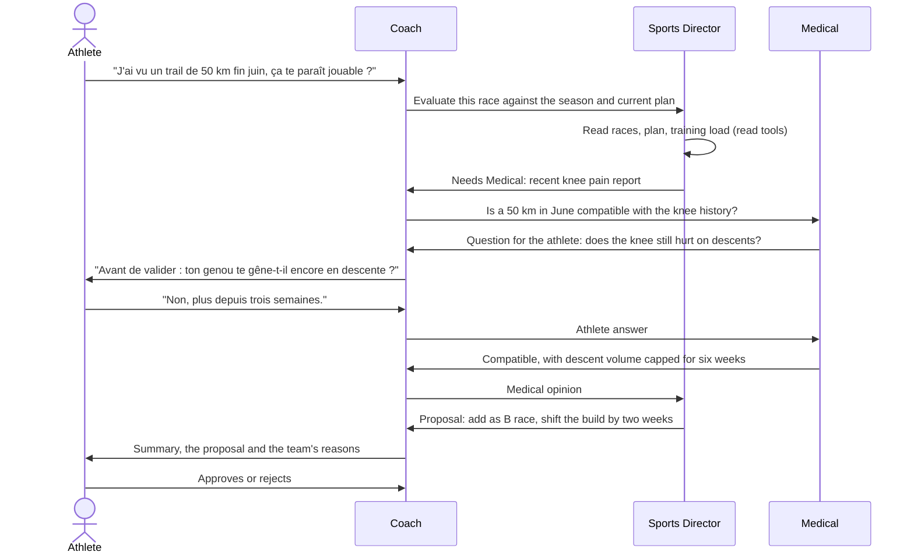

# Proposal: a coaching team for conversations, a single Coach for plans

- Status: Proposal from the product owner (2026-10-14). Direction accepted in decision D10; the detailed design is to be confirmed through Phase 2 issues. It amends [ADR 0007](../../adr/0007-coaching-engine-paradigm-and-agent-topology.md) and [ADR 0010](../../adr/0010-internal-tools-and-garmin-normalized-data.md).
- Inputs: the partial [topology benchmark](topology-benchmark.md) run (34 of 48 plans, no judging), the [reference audit](reference-audit.md) of ai-running-coach, and the current [agents and delegation](agents-and-delegation.md) design.

## Idea in one paragraph

Stride works like the staff of a professional athlete. The **Coach** is the only entry point. It writes and adapts training plans itself, using skills that teach it how to build a plan. When a request needs a specialist, the Coach delegates it to that specialist only: the **Sports Director** for the season and new races, **Medical** for pain, fatigue and injury risk, the **Course Strategist** for a race's course, goal and pacing, and the **Nutritionist** for daily and race-week fueling. Specialists work with their own instructions, skills and read tools, may consult each other through the Coach, and may need answers from the athlete. Every change ends as a proposal that the athlete approves or rejects.

## Decisions taken (2026-10-14)

- Plan generation and adaptation: the single Coach with skills. No multi-agent delegation for plan design.
- Conversations: Coach as the only entry point and voice, specialists consulted through it, the athlete approves every change.
- Model access: the Anthropic API behind the model gateway (D1). Running the product on a Claude subscription through a containerized Claude Code CLI was considered and rejected: subscription login may not power a product used by other people, the quota is shared with development, and the CLI gives no control over run state, caching or concurrency. Subscription CLIs stay for development and evaluations.
- Skills: start from ai-running-coach's skills and keep their substance, replacing file and Python-script steps with Stride tools. Copied files keep the MIT copyright and permission notice in a `NOTICE` file next to them.
- Nutrition: computed targets with a light deficit allowed under guards (see Nutrition method).

## Two modes

| Mode                           | Who works                                                      | Why                                                                                                                                                       |
| ------------------------------ | -------------------------------------------------------------- | --------------------------------------------------------------------------------------------------------------------------------------------------------- |
| Plan generation and adaptation | The Coach alone, with plan-design skills and the validator     | Plan design is one tightly coupled decision. The partial benchmark shows no gain from delegation: more warnings, one invalid plan, 1.5× to 2× the cost.   |
| Conversation and decisions     | The Coach, plus only the specialist the request actually needs | Requests such as "I found a race in June" or "my knee hurts" belong to one domain, need that domain's data and rules, and benefit from a focused context. |

## How a conversation flows

The athlete sees one thread, like a staff group chat. Each specialist contribution is shown with its author ("Le médecin recommande…"), but every message to the athlete goes through the Coach.

## Answers to the open questions

### Should specialists talk to the athlete directly?

No. The Coach stays the only voice, and specialist questions and opinions are relayed with attribution. Reasons:

- one coherent voice: the Coach merges overlapping questions (Medical and the Sports Director should not ask about the knee twice) and resolves contradictions before the athlete sees them;
- one place for the safety boundary, the French tone rules and the numeric guard on explanations;
- simpler state: one conversation, one pending question at a time.

Transparency comes from attribution in the UI, not from direct channels.

### Should specialists talk to each other?

Only through the Coach, with a hard limit: at most two specialist consults per request and no specialist-to-specialist chains. Free agent-to-agent conversation loops, multiplies cost and makes decisions hard to explain. Routing through the Coach keeps every exchange in the run log, so `/why`-style explanations stay possible.

### When is a specialist called?

Only when the request needs its domain, decided by the Coach through a `consult(specialist, question)` tool. Some triggers are deterministic and do not depend on the Coach's judgment:

- an active pain or illness report, or any request touching one, always consults Medical;
- adding, removing or changing the priority of a race always consults the Sports Director;
- a request about a race's course, goal or pacing always consults the Course Strategist.

Simple requests ("quelle allure pour mon footing de demain ?") are answered by the Coach alone with its skills.

## The team

| Agent             | Owns                                                                                                                 | Tools (read only unless stated)                                                                          | Model                                                                |
| ----------------- | -------------------------------------------------------------------------------------------------------------------- | -------------------------------------------------------------------------------------------------------- | -------------------------------------------------------------------- |
| Coach             | Entry point, plan design and adaptation, relaying, final proposal                                                    | Plan, history summary, readiness, consult, ask athlete, create proposal (writes a proposal only)         | Sonnet 5.5; Opus 5.5 for full plan design                            |
| Sports Director   | Season calendar, race roles (A/B/C), spacing between races, objective feasibility at season level                    | Races, plan, training load, feasibility module                                                           | Sonnet 5.5                                                           |
| Medical           | Pain, illness, fatigue, injury risk, return-to-run, referral                                                         | Health reports, readiness, sleep and HRV summaries, deterministic health rules                           | Sonnet 5.5; never a low-cost model, because errors are safety errors |
| Course Strategist | Course analysis, goal realism for this athlete on this course, pacing and aid-station strategy                       | Race workspace (course profile, elevation, weather), thresholds, recent results                          | Sonnet 5.5                                                           |
| Nutritionist      | Daily energy, carbohydrate, protein and fat targets by training day, meal timing, race-week loading, in-race fueling | Profile (age, sex, height, weight), planned sessions, Garmin daily active calories, nutrition calculator | Haiku 5.5, numbers from code                                         |

Each agent is one instruction file plus its own skills, so its context holds only its domain. A cheap model is fine where the numbers come from code and the model only explains them (Nutritionist, intent routing, phrasing). It is not fine where the model's judgment is the safety boundary (Medical).

### Data access: typed tools first, garmin_mcp read tools for drill-down

Each agent starts with a small context packet computed by code (history summary, readiness, plan, races). For questions the packet does not answer, agents decide themselves what to fetch:

- Stride typed tools for Stride data (plan, proposals, races, check-ins, health reports), which garmin_mcp does not hold.
- An allowlist of read-only garmin_mcp MCP tools for Garmin detail (an activity's laps, sleep and HRV for a date range, a past race). garmin_mcp already authenticates the athlete's Supabase token and derives the user, so athlete scope holds.

Guards on the MCP tools are recorded in the [ADR 0010 amendment](../../adr/0010-internal-tools-and-garmin-normalized-data.md#amendment-2026-10-15-130) (#130). Enforced today: the read-only exposed set (garmin_mcp refuses to start otherwise) and the per-agent allowlist (Managed Agents). Not yet enforced: one date or at most 14 days per call is an instruction in the `garmin-data-access` skill, and there is no output size cap until Julestblt/garmin_mcp#12 ships. Tools with known defects stay excluded, for example `get_lactate_threshold`, which misreads Garmin's speed unit. Normalized rows stay the source of truth for anything the validator checks.

## Honest assessment

**What is right in the idea**

- Splitting plan generation (one Coach) from conversation (team) matches what the partial benchmark suggests and what ai-running-coach actually does: its coach writes the plan, the other agents are consulted.
- Domain-specific context is the real benefit of specialists: Medical carries the health rules and the health history, the Course Strategist carries the course profile, without bloating the Coach's context.
- The athlete always decides, which fits the proposal and approval ledger already designed ([ADR 0008](../../adr/0008-versioned-plans-and-proposal-lifecycle.md)).

**What is not automatically true**

- "More agents, more precise" is not guaranteed. Each hand-off loses information and adds latency and cost; a Coach that loads the same skills can often answer as well. Precision comes from the data and the deterministic rules each specialist uses, not from the number of agents. This must be measured, not assumed: every specialist should beat "Coach with the same skill" on its own evaluation scenarios before it ships.
- The group-chat feeling is a product experience. It can be delivered by attribution in one thread while the backend stays a bounded, Coach-orchestrated workflow.

**Risks**

- Cost and latency of chained consults: capped at two consults per request, specialist answers capped in length, results cached per run.
- Contradictions between specialists: the Coach resolves them and shows the trade-off; health always wins over performance.
- Nutrition: wearable calorie estimates are uncertain, so they only feed the NEAT term (see below). A light deficit is allowed with guards; race-weight targets are not. The Nutrition page is a new product surface and needs its own epic.
- Course Strategist overlaps the existing race workspace, which already analyses courses deterministically. The agent should consume that analysis, not redo it.

**Verdict**: viable and a better split than delegating plan design. Build it incrementally: Coach with skills first, then Medical (highest safety value), then the Sports Director, then the Course Strategist on top of the race workspace, and the Nutritionist last with its own page.

## Nutrition method

All numbers come from a deterministic calculator; the Nutritionist explains them and answers questions.

- **Resting energy**: Mifflin-St Jeor from age, sex, height and weight.
- **NEAT**: Garmin daily active calories minus recorded exercise calories, averaged over the last 14 days.
- **Training energy**: from planned sessions, about 1 kcal per kg per km for running plus a climbing term for elevation, so tomorrow's target follows tomorrow's session, not yesterday's watch reading.
- **Daily target** = resting energy × 1.1 (digestion) + NEAT + training energy, shown as a rounded value ("environ 2 200 kcal").
- **Carbohydrates by day**: 3–5 g/kg on rest and easy days, 5–7 g/kg on moderate days, 6–10 g/kg on long or hard days; 8–12 g/kg in the 36–48 hours before races over 90 minutes; 30–60 g/h in training sessions over 90 minutes and 60–90 g/h in ultras.
- **Protein**: 1.6–2.0 g/kg per day spread over 4–5 intakes of 0.3–0.4 g/kg, one within two hours after hard or long sessions, optionally one before sleep.
- **Fat**: the remainder, at least 0.8 g/kg per day.
- **Light deficit**: allowed only when the athlete asks for it, at most 10–15% below the target (about 300–500 kcal), never on long or hard days, in taper or race weeks, and suspended when Medical reports fatigue, illness, injury or repeated poor readiness.

## Implementation

**How multi-agent works technically**: each agent is a separate model conversation with its own system prompt, skills and tools, run through the Claude Messages API with tool use. One agent turn may take several API calls (call, tool result, call). The Coach's `consult(specialist, question)` tool starts a specialist run and returns its structured opinion as the tool result; `ask_athlete(question)` suspends the run, persists its state, and resumes it when the athlete answers. Skills and instructions are cached with prompt caching, so repeated calls mostly pay for new tokens. A simple request costs one to three calls; a request with one consult about four to seven.

**Delivery order**, on top of the Phase 2 foundations (model gateway, run tables, worker, tools, run streaming, evaluation harness):

1. Coach with plan-design skills: plan creation and adaptation, conversation thread, proposals approved by the athlete.
2. Agent runtime for consults: `consult`, `ask_athlete` with suspend and resume, attribution in the thread, consult caps, deterministic triggers, garmin_mcp read allowlist.
3. Medical, with its evaluation scenarios.
4. Sports Director (race calendar and roles).
5. Course Strategist on top of the race workspace.
6. Nutrition calculator, Nutrition page, then the Nutritionist.

Each specialist ships only if it beats the Coach with the same skill on its scenarios.

## Consequences for the current plan

- Plan generation: Coach alone with skills. The multi-agent arm of the topology benchmark is no longer needed for plan design; arms A and C can be compared on the remaining scenarios when quota allows.
- ADR 0007 would change from "deterministic specialists with one bounded consult" to "LLM specialists consulted by the Coach in conversation workflows, deterministic modules underneath them".
- Each specialist ships with its evaluation scenarios (for example: race added mid-season, pain report before a key session, race-week fueling) and is compared with the Coach using the same skill.
- New epics: conversation thread with attribution and athlete questions; Nutrition page.
