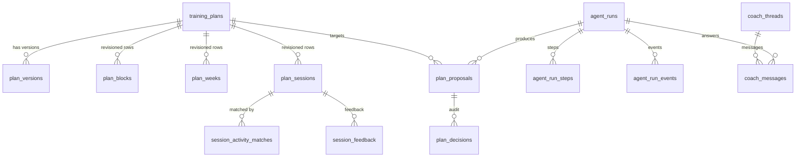

# Data model and versioning

- Status: Accepted (RFC #86, amended by decisions D1–D8 in #94) — migrations are delivered by the Phase 1 and Phase 2 issues
- Decision record: [ADR 0008](../../adr/0008-versioned-plans-and-proposal-lifecycle.md)

## Ownership

All tables below are Stride-owned, live in `public` (or `private` for functions), carry `user_id uuid not null references auth.users (id) on delete cascade`, enable RLS, and follow the existing conventions: owner-only policies with `(select auth.uid()) = user_id`, no `anon` grants, column-level grants, `revision` plus `updated_at` maintained by trigger where rows are athlete-editable. garmin_mcp tables are read under RLS and never referenced by foreign keys ([ADR 0005](../../adr/0005-shared-supabase-schema-ownership.md)); references to activities are stored as plain `uuid` values.

## Plans and versions

| Table            | Key columns                                                                                                                                                                                                                                                                                                                                                                                                                                                                            | Notes                                                                                                   |
| ---------------- | -------------------------------------------------------------------------------------------------------------------------------------------------------------------------------------------------------------------------------------------------------------------------------------------------------------------------------------------------------------------------------------------------------------------------------------------------------------------------------------- | ------------------------------------------------------------------------------------------------------- |
| `training_plans` | `id`, `user_id`, `status` (`active`, `archived`), `title`, `starts_on`, `ends_on`, `primary_race_id` (nullable, `on delete set null`), `active_version`, `time_zone`, timestamps                                                                                                                                                                                                                                                                                                       | At most one `active` plan per athlete (partial unique index). Archived plans stay readable for history. |
| `plan_versions`  | `(plan_id, version)` primary key, `user_id`, `parent_version`, `source_proposal_id`, `created_by` (`athlete`, `coach`, `system`), `effective_from`, `race_roles` (JSON array of race id and plan role), `confidence` (JSON level and French reasons), `summary`, `content_hash` (SHA-256 of the applied changeset), `created_at`                                                                                                                                                       | Immutable once written. Version 1 comes from the accepted `create_plan` proposal.                       |
| `plan_blocks`    | `id` (revision), `plan_id`, `user_id`, `block_key`, `valid_from_version`, `valid_to_version`, `kind` (`lead_in`, `base`, `build`, `specific`, `taper`, `race`, `recovery`, `transition`), `name`, `starts_on`, `ends_on`, `objective`, `race_id`                                                                                                                                                                                                                                       | Revisioned                                                                                              |
| `plan_weeks`     | `id`, `plan_id`, `user_id`, `week_key`, version range, `week_start` (Monday), `block_key`, `week_type` (`build`, `recovery`, `taper`, `race`, `lead_in`, `post_race`), `target_duration_s`, `target_distance_m`, `target_elevation_m`, `quality_sessions`, `long_run_target_s`, `intensity_split`, `notes`                                                                                                                                                                             | Revisioned                                                                                              |
| `plan_sessions`  | `id`, `plan_id`, `user_id`, `session_key`, version range, `scheduled_on`, `sport` (`run`, `trail`, `strength`, `cross`, `rest`), `kind` (`easy`, `long`, `recovery`, `tempo`, `threshold`, `intervals`, `hills`, `race_specific`, `race`, `strength`, `mobility`, `cross`, `rest`), `title`, `purpose`, `is_key`, `priority`, `targets` (JSON), `structure` (JSON steps), `terrain`, `origin` (`template`, `coach`, `athlete`), `contingencies` (JSON array of short French fallbacks) | Revisioned; `structure` validated by a shared Zod schema and complete for every session (D6)            |

### Session structure

`structure` stores ordered steps compatible with how watches describe workouts, so a later Garmin export stays possible without a data migration. Every session of every week carries a complete structure from creation (D6); there is no provisional session or week:

| Field    | Values                                              |
| -------- | --------------------------------------------------- |
| `type`   | `warmup`, `work`, `recovery`, `cooldown`, `repeat`  |
| `end`    | `time` (seconds), `distance` (metres), `lap_button` |
| `target` | `heart_rate_range`, `pace_range`, `rpe`, `none`     |
| `repeat` | count and nested steps                              |
| `cue`    | short French instruction                            |

### How versions work

- Each logical session has a stable `session_key`. A row is valid for versions `valid_from_version ≤ v < valid_to_version` (`null` meaning current).
- Reading the active plan: rows with `valid_to_version is null`. Reading version `v`: the range predicate. Indexes on `(plan_id, valid_to_version, scheduled_on)` and `(plan_id, session_key)`.
- Applying an accepted proposal in one transaction:
  1. lock the `training_plans` row and check `active_version = base_version`;
  2. reject any change to a session dated before the athlete's local today or present in `session_activity_matches`;
  3. close changed or removed rows with `valid_to_version = new_version`;
  4. insert new revisions with `valid_from_version = new_version`;
  5. insert `plan_versions`, update `active_version`, insert the `plan_decisions` row, and mark the proposal `applied`.
- Unchanged rows are shared between versions, so a one-session change writes two rows, not a plan copy.
- The database enforces steps 1–2 inside the private apply function. The changeset itself is computed by tested TypeScript in the worker, which is the only caller.
- `private.apply_plan_proposal(proposal_id, changeset)` takes the `PlanChangeset` JSON produced by `computeChangeset` and is executable only by the `stride_coach_worker` role; `authenticated` and `service_role` cannot call it. Plan header fields on `training_plans` reflect the current version; race roles and confidence live on `plan_versions`. Applying a `new_plan` proposal archives the previous active plan.
- The apply function rejects with `frozen_session` any changeset that closes a session dated before local today or having any row in `session_activity_matches`, including an athlete dismissal (#104).

## Proposals and decisions

| Table            | Key columns                                                                                                                                                                                                                                                                                                                                                                                                                                                                                                                                                                                                                                      | Notes                                                            |
| ---------------- | ------------------------------------------------------------------------------------------------------------------------------------------------------------------------------------------------------------------------------------------------------------------------------------------------------------------------------------------------------------------------------------------------------------------------------------------------------------------------------------------------------------------------------------------------------------------------------------------------------------------------------------------------ | ---------------------------------------------------------------- |
| `plan_proposals` | `id`, `user_id`, `plan_id` (null for `create_plan`), `base_version`, `scope` (`session`, `week`, `block`, `plan`, `new_plan`, `undo`), `origin` (`training`, `recovery`, `performance`, `schedule`, `race`), `requested_by` (`athlete`, `system`), `status`, `title`, `summary`, `rationale`, `operations` (JSON, typed), `preview` (JSON before/after), `validation` (JSON report), `evidence` (JSON `EvidenceRef[]`), `assumptions` (JSON), `uncertainty` (`level`, reasons), `specialist_opinions` (JSON), `target_keys` (array of session, week or block keys), `agent_run_id`, `expires_at`, `superseded_by`, `applied_version`, timestamps | Written only by the worker; read by the owner                    |
| `plan_decisions` | `id`, `user_id`, `proposal_id`, `decision` (`accepted`, `rejected`, `expired`, `superseded`, `stale`, `applied`, `reverted`), `actor` (`athlete`, `system`), `note`, `resulting_version`, `created_at`                                                                                                                                                                                                                                                                                                                                                                                                                                           | Append-only audit trail for the Historique screen and CSV export |

Only the worker writes `plan_proposals`. The athlete's accept, reject, undo and note actions go through RPCs that validate ownership and state, write a `plan_decisions` row, and enqueue the apply run.

## Adherence, feedback and health reports

| Table                       | Key columns                                                                                                                                                                                                                                                                                                                                          | Notes                                                                                                                                                                                                                            |
| --------------------------- | ---------------------------------------------------------------------------------------------------------------------------------------------------------------------------------------------------------------------------------------------------------------------------------------------------------------------------------------------------- | -------------------------------------------------------------------------------------------------------------------------------------------------------------------------------------------------------------------------------- |
| `session_activity_matches`  | `id`, `user_id`, `plan_id`, `session_key`, `session_revision_id`, `activity_id` (garmin_mcp uuid, no foreign key; null for a dismissal), `method` (`auto`, `athlete`), `confidence`, `status` (`completed`, `partial`, `substituted`, `dismissed`), `compliance` (JSON: duration, distance and intensity ratios), `algorithm_version`, `computed_at` | `auto` rows are written by `refresh_session_matches` for the athlete's active plan; athlete overrides go through an RPC. Rows whose activity disappears after a Garmin data deletion are removed by the next day's recomputation |
| `session_feedback`          | `id`, `user_id`, `session_key`, `activity_id`, `rpe` (1–10), `feel` (`great`, `good`, `ok`, `hard`, `very_hard`), `note` (≤ 500 characters), timestamps                                                                                                                                                                                              | Athlete-authored                                                                                                                                                                                                                 |
| `athlete_condition_reports` | `id`, `user_id`, `kind` (`pain`, `illness`, `fatigue`, `other`), `body_area` (closed list), `severity` (0–10), `started_on`, `resolved_on`, `status` (`active`, `monitoring`, `resolved`), `note` (≤ 280 characters), `source` (`athlete`, `coach_confirmed`), timestamps                                                                            | Health data; athlete-authored or confirmed by the athlete when extracted from a conversation                                                                                                                                     |

### Matches

- `activity_id` is null only for an athlete dismissal (status `dismissed`, “Pas faite”): the session counts as missed and auto matching skips it. `(plan_id, activity_id)` is unique, so an activity matches at most one session; a session may have several activities (split). Rest sessions are never matched, and `missed` is derived, never stored.
- `private.record_session_matches(plan_id, matches, algorithm_version)`, executable only by `stride_coach_worker`, replaces the plan's `auto` rows with the matcher output, derives `user_id` from `training_plans`, and skips any session or activity covered by an `athlete` row.
- `public.refresh_session_matches(plan_id, version, matches, algorithm_version, activities_through)` (#158) lets the authenticated athlete record the matcher output for their own active plan. It rejects a foreign or inactive plan with `not_found` (PT404) and a version other than `active_version` with `stale_version` (PT409). Then it delegates to `private.record_session_matches` and stamps three columns on `training_plans`:
  - `matches_computed_at`;
  - `matches_version`;
  - `matches_activities_through`, the latest activity `updated_at` that the matcher read.

  The athlete could already link any activity through `set_session_match`, so this grants no new power over their own plan.

- `refreshSessionMatches` (`src/server/plans/auto-matches.ts`) runs inside `loadPlanOverview`. The app shell calls it on every authenticated page, and Plan, the session panel and Progression share it per request. Each render costs two small reads. The matcher runs again only when:
  - the marker is missing or the plan version changed;
  - an activity changed after `matches_activities_through` (garmin_mcp bumps `updated_at` on every upsert, so new and corrected activities both count);
  - the plan's local day changed.

  Comparing activity times rather than the write time means an activity saved during a refresh still triggers the next one. A deleted activity is only dropped at the next local day. The local day of an activity comes from `local_started_at`. A failed refresh leaves the stored matches in place.

- `public.set_session_match(plan_id, session_key, activity_ids, status)` lets the athlete link activities to a current, non-rest session of their active plan, or dismiss it with an empty list. Its rows replace the session's rows, remove other rows for the same activities, and store null compliance ratios. `public.clear_session_match(plan_id, session_key)` removes the athlete rows and returns the session to auto matching. Errors: `not_found` (PT404) for a foreign plan or unknown session. Like every Stride migration, these functions never read garmin_mcp tables (ADR 0005), so activity ids are not checked against `provider_activities`; RLS on that table already limits what the athlete can read and link in the product.
- The matcher (`src/features/plans/matching`) is pure and versioned. Progression's Régularité reads persisted rows for the active plan, which are refreshed first when stale.

Existing `athlete_wellness_checkins` stays the daily check-in.

## Conversation, memory and questions

| Table                  | Key columns                                                                                                                                                                                                                                                                                         | Notes                                                                                              |
| ---------------------- | --------------------------------------------------------------------------------------------------------------------------------------------------------------------------------------------------------------------------------------------------------------------------------------------------- | -------------------------------------------------------------------------------------------------- |
| `coach_threads`        | `id`, `user_id`, `local_date`, `created_at`                                                                                                                                                                                                                                                         | One thread per local day, matching "Les conversations se réinitialisent chaque matin"              |
| `coach_messages`       | `id`, `thread_id`, `user_id`, `role` (`athlete`, `coach`), `content` (≤ 4,000 characters), `proposal_ids`, `agent_run_id`, `created_at`                                                                                                                                                             | Athlete messages through an RPC; coach messages by the worker                                      |
| `athlete_memory_facts` | `id`, `user_id`, `category` (`preference`, `constraint`, `habit`, `history`), `statement` (≤ 200 characters, French), `structured` (JSON, optional), `provenance` (`declared`, `observed`, `followed_up`), `evidence`, `status` (`active`, `retired`), `created_by_run`, `confirmed_at`, timestamps | "Ce que je sais de toi"; the athlete can edit or retire any fact; health facts are not stored here |
| `coach_questions`      | `id`, `user_id`, `question`, `options` (JSON), `reason`, `status` (`open`, `answered`, `dismissed`), `answer`, `created_by_run`, timestamps                                                                                                                                                         | "2 questions pour affiner ton plan"                                                                |
| `coach_settings`       | `user_id` (primary key), `proactive_reviews`, timestamps                                                                                                                                                                                                                                            | Coaching preferences; no consent or budget columns (D2, D4)                                        |

## Agent execution and provenance

| Table              | Key columns                                                                                                                                                                                                                                                                                                                                                                                                                                                                                   | Notes                                                                                                 |
| ------------------ | --------------------------------------------------------------------------------------------------------------------------------------------------------------------------------------------------------------------------------------------------------------------------------------------------------------------------------------------------------------------------------------------------------------------------------------------------------------------------------------------- | ----------------------------------------------------------------------------------------------------- |
| `agent_runs`       | `id`, `user_id`, `workflow`, `trigger` (`athlete`, `schedule`, `monitor`), `status` (`queued`, `running`, `waiting`, `succeeded`, `failed`, `cancelled`, `expired`), `idempotency_key` (unique per user), `input` (JSON, minimal), `budget` (JSON caps), `usage` (JSON tokens and cost by model), `config` (routing table and prompt versions), `attempts`, `lease_owner`, `lease_expires_at`, `next_attempt_at`, `cancel_requested_at`, `error_code`, `result` (JSON references), timestamps | Job record and audit; partial unique index allows one queued or running plan-mutating run per athlete |
| `agent_run_steps`  | `id`, `run_id`, `user_id`, `step_key` (unique per run), `kind` (`deterministic`, `llm`, `tool`, `validation`, `consult`), `name`, `status`, `attempt`, `model`, `effort`, `input_digest`, `output` (JSON, minimized), `usage`, `cost_usd`, `latency_ms`, `error_code`, timestamps                                                                                                                                                                                                             | Memoization and provenance; `output` kept with the run                                                |
| `agent_run_events` | `id`, `run_id`, `user_id`, `seq`, `type`, `payload`, `created_at`                                                                                                                                                                                                                                                                                                                                                                                                                             | Streaming source; athlete-visible content only                                                        |

Provenance chain for any change shown in Historique: decision → proposal (evidence, assumptions, uncertainty, validator report, opinions) → run (workflow, models, prompt versions, usage) → steps.

## Access matrix

| Table group                              | Athlete (`authenticated`)                                      | Worker role                                 | Web server                  |
| ---------------------------------------- | -------------------------------------------------------------- | ------------------------------------------- | --------------------------- |
| Plans, versions, blocks, weeks, sessions | Select own                                                     | Write through private apply function only   | Reads as athlete            |
| Proposals                                | Select own                                                     | Insert and update through private functions | Reads as athlete            |
| Decisions                                | Select own; insert through accept, reject, undo RPCs           | Insert (apply, expire, supersede, stale)    | Calls RPCs as athlete       |
| Matches                                  | Select own; override through RPC                               | Write                                       | Reads as athlete            |
| Feedback, condition reports, check-ins   | Select, insert, update own                                     | Read as athlete                             | Reads and writes as athlete |
| Threads, messages                        | Select own; insert messages through RPC                        | Insert coach messages                       | Calls RPCs as athlete       |
| Memory facts, questions                  | Select own; edit or retire facts; answer questions through RPC | Insert                                      | Calls RPCs as athlete       |
| Runs, steps, events                      | Select own runs and events (steps' `output` not exposed)       | Write                                       | Reads as athlete            |

Every RPC is `security definer`, sets `search_path = ''`, derives the athlete from `auth.uid()` (athlete RPCs) or from the run row (worker functions), and checks state transitions. pgTAP tests cover each table for cross-athlete reads and writes, as the existing onboarding, race and wellness tests do.

## Recompute, cache or persist

| Data                                            | Choice                           | Reason                                        |
| ----------------------------------------------- | -------------------------------- | --------------------------------------------- |
| History summary, readiness, spikes, load series | Recompute per run                | Cheap; always consistent with the latest sync |
| Athlete context packet                          | Cache per run (step memo)        | Stable within a run; shared by all steps      |
| Plan versions, proposals, decisions             | Persist                          | Auditable history                             |
| Matches and adherence                           | Persist                          | Athlete overrides and frozen history          |
| Validator reports                               | Persist on the proposal          | Explanations and audits                       |
| Model outputs                                   | Persist minimized in steps       | Debugging and memoization                     |
| Race demands                                    | Recompute from the stored course | Course edits must flow through                |

## Retention and deletion

No time-based purge (decision D2, [risks and decisions](risks-and-decisions.md)). Every row lives as long as the account, the athlete can delete their own athlete-authored rows (feedback, condition reports, memory facts), and everything is deleted by `on delete cascade` with the account. Plans, versions, proposals, decisions and matches stay exportable. If storage volume ever requires it, a cleanup of run events and step outputs is an operational change, not a privacy rule.

## Size estimate

Assumptions: a 24-week plan has about 150 sessions, all fully structured; about 120 session revisions per year from adaptations; 600 runs, 2,500 steps and 1,000 messages per active athlete per year. Rows are small except `operations`, `structure` and step outputs. Without purges, the expected footprint is roughly 5–10 MB per active athlete per year — negligible for a handful of athletes and far within Supabase Pro's 8 GB included disk ([Supabase pricing](https://supabase.com/pricing), fetched 2026-10-12). These are estimates to be replaced by measurements.
