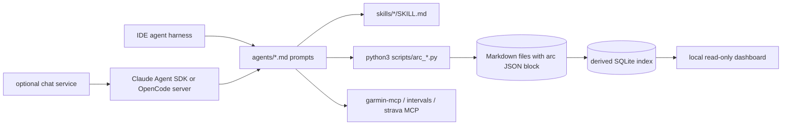

# Reference audit: ai-running-coach

- Status: Accepted (RFC #86)
- Subject: [mmornati/ai-running-coach](https://github.com/mmornati/ai-running-coach) at commit `ece024c` (tag v1.2.0, released 2026-10-12), read on 2026-10-12
- Method: full clone, reading of agents, skills, scripts, configuration, contracts, tests and CI history. No upstream code was executed.

## Summary

- ai-running-coach is a mature, single-athlete coaching workspace for IDE agents (Claude Code, Copilot, OpenCode, Gemini CLI, Cursor, Windsurf). 625 commits since 2026-09-18, five agents, 22 skills, about 80 Python scripts and 3,466 deterministic test functions.
- Its most valuable part is not the agents but the deterministic layer: a guardrail engine with explicit skip conditions and evidence notes, periodization templates validated against those guardrails, a plan-skeleton generator that derives peak volume from what the athlete already holds, and a decision log that `/why` can explain without inventing reasons.
- Its agents are long procedural prompts (the coach prompt is 645 lines, about 52 KB) written for a coding-agent harness that reads Markdown files, runs Python CLIs and calls MCP tools. That control model does not fit a multi-tenant web product.
- Its behavioral evaluation suite (75 scenario cases) exists, but the latest scheduled CI run skipped all 75 cases because no API key was configured, and `tests/evals/RESULTS.md` reads "jamais exécuté". The prompts are therefore not evidenced as evaluated.
- License: MIT. Concepts can be reused freely. Copying code or data files requires keeping the copyright and permission notice. This RFC recommends reimplementing in TypeScript and copying nothing.

## How the reference works

- One athlete per installation. Markdown files in `activities/`, `medical/`, `nutrition/`, `planning/` and `rapports/` are the source of truth. Each file opens with a fenced `arc` JSON block validated by `arc_contract.py`; a disposable SQLite index is rebuilt from the files.
- Agents are delegated through the IDE's `task` tool, only to agents listed in `[agents].enabled`. A delegated prompt is written in English and asks for an answer in the document language.
- An optional chat service (`deploy/chat`) runs the same prompts behind Traefik and SSO through either the Claude Agent SDK or a supervised `opencode serve`. It adds a policy engine (`allow` / `ask` / `deny` per tool), approvals bound to a payload hash, daily budgets and an SSE event protocol. It is explicitly single-user and explicitly excludes Claude Pro/Max or ChatGPT subscriptions for third-party front ends.

## Agents

| Agent               | Responsibility in the reference                                                                                                    | Notable rules                                                                                                                                                                                                                                                                 | Assessment for Stride                                                                                                                                     |
| ------------------- | ---------------------------------------------------------------------------------------------------------------------------------- | ----------------------------------------------------------------------------------------------------------------------------------------------------------------------------------------------------------------------------------------------------------------------------- | --------------------------------------------------------------------------------------------------------------------------------------------------------- |
| `coach`             | Plans, Garmin analysis, session changes, Garmin calendar push, weekly reports, morning health check                                | Starts new blocks from templates; "the peak is derived, never chosen"; runs guardrails before writing or pushing a week; writes a decision record for every changed session; style never changes the verdict                                                                  | Keep the rules; replace the prompt-driven procedure with code workflows. The 52 KB prompt mixes configuration, data-source mapping and coaching judgment. |
| `sports-director`   | Choosing races and the next objective, season calendar with roles (main objective, preparation, fun)                               | Feasibility before search; says plainly when a goal is unrealistic, then re-targets; never computes dates mentally; provisional spacing rules by race size; never edits the objective, only proposes values; medical consult mandatory for a step-up race with an open injury | Strong fit for multi-race planning. Race web search is out of scope; the spacing rules become deterministic calendar checks labeled as conventions.       |
| `course-strategist` | GPX or race URL to race plan: three pace scenarios, aid stations, water points, night, technicity, altitude, debrief recalibration | Never invents data; asks for missing cut-offs; personal coefficients written only after explicit consent                                                                                                                                                                      | Stride's race workspace already covers course analysis deterministically (E-06). Only race demands feed training plans.                                   |
| `medical`           | Sleep, HRV, recovery, injury protocols, availability gatekeeper (green/amber/red)                                                  | Non-diagnostic wording, mandatory disclaimer on the injury-risk flag, consultation when pain reaches 7/10                                                                                                                                                                     | Keep the gatekeeper and referral logic. Drop "immediate protocols (stretches, rest, RICE)", which moves toward treatment advice.                          |
| `nutritionist`      | Macros, race weight, fueling plans, optional push to the Garmin food log                                                           | Garmin calories are the reference; the energy model is only a control                                                                                                                                                                                                         | Defer. Race-weight targets carry energy-deficiency risk (see the 2023 IOC REDs consensus). Race fueling already lives in Stride's race workspace.         |

The reference has no explicit circular-delegation guard beyond "only delegate to enabled agents". A sports-director launched as a subagent cannot consult others and returns open points ("À valider avec le coach : …") that the coach must resolve first. This depth-one pattern is the right instinct and is kept, enforced in code rather than in prompt text.

## Skills and procedures worth studying

| Skill                       | What it teaches                                                                                                                                                                                                          |
| --------------------------- | ------------------------------------------------------------------------------------------------------------------------------------------------------------------------------------------------------------------------ |
| `why`                       | Explain a decision only from logged fields; say "no decision found" rather than invent one; read-only.                                                                                                                   |
| `week`, `today`, `race`     | Short factual commands that never modify plans.                                                                                                                                                                          |
| `log`                       | The model extracts entities from free text; deterministic code does the arithmetic and catalog matching; unknown products are always asked about.                                                                        |
| `garmin-sync-efficiency`    | Garmin MCP responses are verbose; the reference observed five context compactions in one session and sleep payloads above 400 KB, and responds with one date per call, immediate persistence and no raw JSON in context. |
| `workspace-data-contract`   | A typed contract for every persisted file: SI units, an absent measurement is omitted rather than set to zero, validation after every write.                                                                             |
| `garmin-workout-scheduling` | The exact Garmin workout structure (segments, steps, end conditions, targets, repeat groups), idempotency and verify-after-push.                                                                                         |

## Deterministic layer

### Guardrails (`arc_guardrails.py`, 110 tests)

| Rule | Check                                                                       | Default         | Upstream evidence label          |
| ---- | --------------------------------------------------------------------------- | --------------- | -------------------------------- |
| R1   | Projected acute:chronic ratio, maximum over the proposed week               | warn above 1.3  | Literature, explicitly contested |
| R2   | Weekly duration (and distance on road) increase vs mean of previous 4 weeks | warn above +10% | Project convention               |
| R3   | Weekly elevation increase (trail)                                           | warn above +10% | Project convention               |
| R4   | Projected Foster monotony                                                   | warn above 2.0  | Literature                       |
| R5   | Quality session on or after a red health verdict                            | block           | Project rule                     |
| R6   | Longest run share of weekly volume (with at least 4 runs)                   | warn above 35%  | Project convention               |
| R7   | Two quality sessions on the same or consecutive days                        | warn            | Literature                       |

What makes the engine trustworthy is its explicit non-evaluation: R1 is skipped below 84 days of history (an exponential moving average starting cold reads ratios of 3.18 to 1.34 on stable weeks), R4 below 14 days, R6 with fewer than 4 runs, R2/R3 without a reference week, distance-only sessions without a recent pace, race weeks except R5, and the week after a race is compared with a full-rest counterfactual. Each skip carries a `reason_code`. Exit codes separate "blocked" from "invalid input". A block blocks only the flagged session, never the whole week.

A composite injury-risk flag adds declared pain (double weight), effort-versus-heart-rate mismatch, sleep debt and a red verdict. Its levels are labeled as project conventions, a skipped factor never counts as favorable, and every output carries a non-diagnostic disclaimer.

### Periodization templates and plan skeleton (117 tests)

- Six JSON templates (short trail, trail marathon, 80–100 km, 100 miles, road half, road marathon) with five phases each: weeks min/max, volume as a percentage of the peak week, intensity split, quality-session ceiling, long-run share and cap, strength emphasis and a recovery week every N weeks.
- Deterministic stretch and compress rules, and a validator that checks every resolvable block length against the guardrails.
- The central rule: the peak equals the average of the last four weeks times a template factor, never more. A template describes the shape of a block from the volume the athlete already holds. When that peak is too low for the goal, the coach says so and proposes a lead-in block or a revised goal instead of stretching the template.
- The skeleton is dated from this Monday (or the next one), places placeholder slots on available days, passes every week through the guardrails, reduces a violating week and refuses to emit a week that still blocks. A `race_demand` check reports when the peak long run or weekly elevation stays far below what the race needs.
- All numbers are labeled "approximations du projet". Only the direction of two choices cites literature: taper reduces volume and keeps intensity (Mujika and Padilla 2003), and intensity distribution leans polarized (Seiler 2010).

### Other modules

- Load forecast: projects condition, fatigue and the acute:chronic ratio to race day from planned sessions, rescaled by the athlete's real-versus-estimated ratio when enough pairs exist, and labeled as an estimate.
- Decision effects: before/after windows per decision trigger, tolerances labeled as conventions, trends only from five cases, and "correlation, not causation". It is never used to relax a block.
- Planned-versus-completed matching: same date and sport family, explicit statuses first, past unmatched sessions are missed, today's are pending.
- An `ASSUMPTIONS` registry in each module states every method, threshold and source in one place.

## Memory and traceability

- Long-term memory is the Markdown history plus a derived index; a RAG server exists only in a separate VPS deployment.
- A decision record captures the trigger (`morning_check`, `guardrail`, `athlete_request`, `medical`, `weather`, `race`, `other`), rule ids, inputs, before and after, session reference and outcome (`proposed`, `applied`, `rejected_by_athlete`, `superseded`). A replacement writes a new record that supersedes the old one; published records are never edited.
- Headless runs never apply a change; they record a `proposed` decision only.

## Evaluation and testing

| Tier                     | Content                                                                                                                                                                                    | Evidence of execution                                                                           |
| ------------------------ | ------------------------------------------------------------------------------------------------------------------------------------------------------------------------------------------ | ----------------------------------------------------------------------------------------------- |
| Deterministic unit tests | 3,466 test functions under `tests/data`                                                                                                                                                    | Run in CI                                                                                       |
| Lint and install tests   | Documentation drift, workflow guards, sandboxed installs                                                                                                                                   | Run in CI                                                                                       |
| Behavioral evals         | 75 TOML scenarios: prompt, fixture workspace, stub MCP servers, assertions on tools not called, files written, contract fields, regex matches, word limits; three repetitions, pass at 2/3 | Latest scheduled run (2026-10-12) logged an empty API key and "Ran 100 tests … OK (skipped=75)" |

The scenario format is a good template for Stride. The lesson is that an evaluation suite only counts when it runs with a budget and its results are recorded.

## Reuse matrix

| Category                                      | Item                                                                                                                        | Stride decision                                                                                                                                                                                                  |
| --------------------------------------------- | --------------------------------------------------------------------------------------------------------------------------- | ---------------------------------------------------------------------------------------------------------------------------------------------------------------------------------------------------------------- |
| Reuse with minimal change (concepts, no code) | Proposal-before-write discipline: a block blocks one session, alternatives are proposed, applied only after athlete consent | Becomes the proposal lifecycle ([ADR 0008](../../adr/0008-versioned-plans-and-proposal-lifecycle.md))                                                                                                            |
|                                               | Skip-with-reason semantics (`reason_code`) and "a missing signal is never favorable"                                        | Validator contract                                                                                                                                                                                               |
|                                               | Decision record fields and supersede-never-edit protocol                                                                    | `plan_proposals` and `plan_decisions`                                                                                                                                                                            |
|                                               | `/why` contract: explain only from logged fields                                                                            | Explanation workflow                                                                                                                                                                                             |
|                                               | "Peak derived from held volume, never chosen"                                                                               | Skeleton rule                                                                                                                                                                                                    |
|                                               | Scenario evaluation format with stub data sources and structural assertions                                                 | `tests/evals/coaching`                                                                                                                                                                                           |
|                                               | Approval bound to an exact payload, pending state with expiry                                                               | Proposal hash and expiry                                                                                                                                                                                         |
| Adapt to Stride                               | Guardrails R1–R7                                                                                                            | Re-graded by evidence: single-session spike becomes the primary relative-load rule; ACWR becomes information only; weekly caps stay as labeled conventions ([deterministic coaching](deterministic-coaching.md)) |
|                                               | Periodization templates                                                                                                     | Stride-owned data, same structure, reviewed numbers, covering 10 km road which the reference lacks                                                                                                               |
|                                               | Sports-director spacing rules and race roles                                                                                | Deterministic race-calendar check plus a Sports Director consult                                                                                                                                                 |
|                                               | Medical gatekeeper and injury-risk flag                                                                                     | Recovery & Health readiness assessment with stricter non-diagnostic limits                                                                                                                                       |
|                                               | Planned-versus-completed matching                                                                                           | Stored matches with athlete override                                                                                                                                                                             |
|                                               | Load forecast                                                                                                               | Later phase, after real planned-versus-actual data exists                                                                                                                                                        |
| Reimplement with Stride's stack               | Agents and skills                                                                                                           | TypeScript workflows, Zod schemas, bounded tool loop, model gateway                                                                                                                                              |
|                                               | Policy engine and approvals                                                                                                 | Database roles, RLS, typed tools, proposal RPCs                                                                                                                                                                  |
|                                               | Markdown contract and SQLite index                                                                                          | Supabase tables with RLS                                                                                                                                                                                         |
|                                               | Chat service and SSE protocol                                                                                               | Next.js route handlers streaming run events                                                                                                                                                                      |
| Defer or exclude                              | Garmin calendar push, food log push, gear sync                                                                              | Deferred: requires garmin_mcp write capability and product decision                                                                                                                                              |
|                                               | Race search on the web                                                                                                      | Excluded for now                                                                                                                                                                                                 |
|                                               | Nutrition macros, race weight                                                                                               | Excluded pending safety review                                                                                                                                                                                   |
|                                               | Menstrual cycle context                                                                                                     | Deferred, strict opt-in only                                                                                                                                                                                     |
|                                               | Critical speed, heat, altitude, night and technicity coefficients                                                           | Deferred to E-06 race intelligence                                                                                                                                                                               |
|                                               | IDE harnesses, installer, Telegram, macOS app, Open Wearables                                                               | Not applicable                                                                                                                                                                                                   |
|                                               | Coding-agent runtimes (Claude Agent SDK, OpenCode server)                                                                   | Excluded for a multi-tenant product: filesystem and shell-shaped tools, per-session workspaces                                                                                                                   |

## License and attribution

- ai-running-coach: MIT, "Copyright (c) 2026 ai-running-coach contributors". Reusing ideas, rule structures and evaluation formats needs no notice. Copying source files or data files, including the template JSON, requires the copyright and permission notice in the copy.
- Recommendation: copy no upstream code or data. Credit the project in the coaching-engine documentation as a conceptual reference, as [the product vision](../../product/vision.md) already does. If an implementation issue later copies a substantial portion, it must add a third-party notice in the same pull request.
- The reference cites literature in its `ASSUMPTIONS` registries. Stride cites the primary sources directly ([deterministic coaching](deterministic-coaching.md)) rather than the reference's summaries.
- The reference avoids TrainingPeaks trademarks (TSS, CTL, ATL, TSB and similar) and uses generic terms. Stride's existing UI already uses generic French terms (condition, fatigue, forme) and Garmin's own metric names; keep that practice.

## Lessons for Stride

1. Deterministic code should own every number, date and constraint. The model chooses among valid options and explains them.
2. Make skip conditions and missing data first-class outputs, not silent defaults.
3. Never let a model write the plan. The reference achieves this with prompt discipline; Stride enforces it with database privileges.
4. Do not feed raw provider payloads to a model. Summaries computed from normalized data are cheaper and more reliable.
5. An evaluation suite must run, with a budget, on every prompt or model change, and its results must be versioned.
6. Prompts accumulate configuration and integration rules over time. Keep those in code so prompts stay about coaching judgment.
