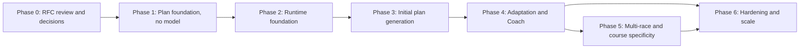

# Phased implementation roadmap

- Status: Proposed (RFC #86)
- Implementation issues are **not** created by this RFC. Per the [planning workflow](../../planning-workflow.md), issues are created for near-term work once the architecture and the blocking product decisions are accepted. The issue drafts below are ready to file then.

## BMAD path after this RFC

1. Product owner reviews this RFC and records decisions D1–D8 ([risks and decisions](risks-and-decisions.md)) in issue #86.
2. Update the PRD with stable requirement IDs for plan generation, adaptation, proposals, multi-race planning and the coach conversation (BMAD PRD workflow), and refine E-04, E-05 and E-06 where scope changes.
3. Mark the accepted ADRs (0007–0012) as Accepted, or amend them.
4. Run the BMAD spec workflow for Phase 1 and create its issues; later phases get a spec and issues when they become near-term.

## Phases

| Phase | Goal                                                                                       | Exit criteria                                                                                                       |
| ----- | ------------------------------------------------------------------------------------------ | ------------------------------------------------------------------------------------------------------------------- |
| 0     | Decisions D1–D8; PRD requirements; accepted ADRs                                           | Issue #86 records decisions; PRD merged                                                                             |
| 1     | Deterministic plan model, validator, skeleton, matching, schema and read-only plan UI      | Deterministic plans built from fixtures pass all rule tests; RLS tests pass; plan screens render a proposal preview |
| 2     | Model gateway, run tables, worker service, tools, SSE, evaluation harness                  | A fake-model workflow runs end-to-end in CI; a live smoke run succeeds in staging within budget                     |
| 3     | Workflow A end to end                                                                      | Acceptance criteria met on the initial-plan scenarios; human coach review passes; consent in place                  |
| 4     | Workflows B, C, E; Coach screen; Historique; monitors; weekly review                       | Adaptation scenarios pass; undo works; monitor costs within estimates                                               |
| 5     | Workflow D; race demands in specific phases                                                | Multi-race scenarios pass; expert label agreement ≥ 90%                                                             |
| 6     | Quotas UI, cost views, residency switch if chosen, garmin_mcp feeds, downgrade experiments | Cost and latency targets hold at pilot scale                                                                        |

## Proposed Stride issues

### Phase 1 — Plan foundation

| Draft title                                           | Scope                                                                                                                                                                      | Acceptance highlights                                                                                                             | Depends on        |
| ----------------------------------------------------- | -------------------------------------------------------------------------------------------------------------------------------------------------------------------------- | --------------------------------------------------------------------------------------------------------------------------------- | ----------------- |
| [Feature]: Plan domain model and typed operations     | `src/features/plans`: plan, block, week, session types; session structure schema; operation union; changeset computation from operations                                   | Unit tests for every operation, including frozen-session rejection and supersede rules                                            | Phase 0           |
| [Feature]: Deterministic validator and rule catalogue | Rules I1–I4, C1–C3, H1–H3, E1–E2, P1–P8, D1 with grades, severities, skips; versioned thresholds                                                                           | Boundary tests per rule; report schema; no rule without a test                                                                    | Plan domain model |
| [Feature]: Templates, skeleton and session library    | Event-family templates, held-volume peak, lead-in, recovery weeks, taper, race week, availability slots, workout library, targets                                          | Skeleton never emits a blocked week across fixtures; taper and recovery invariants; 10 km to trail 60 km coverage                 | Validator         |
| [Feature]: Plan and proposal schema with RLS          | Migrations for plans, versions, revisioned rows, proposals, decisions, matches, feedback, condition reports, coach settings; private apply function; pgTAP isolation tests | Cross-athlete tests pass; frozen-row and version checks enforced in SQL; applying to any hosted project is an approval checkpoint | Plan domain model |
| [Feature]: Planned-versus-completed matching          | Matching module, persisted matches, athlete override RPC, Progression "Régularité" measure                                                                                 | Fixture tests for same-day, moved and substituted sessions; the consistency empty state is replaced                               | Schema            |
| [Feature]: Plan screens (read-only)                   | Plan week view, session detail and proposal preview following `design/references/app/plan` and `workout-detail`, French copy                                               | Visual match at desktop and mobile; renders a fixture proposal; no actions yet                                                    | Schema            |

### Phase 2 — Runtime foundation

| Draft title                                         | Scope                                                                                                                                      | Acceptance highlights                                                     |
| --------------------------------------------------- | ------------------------------------------------------------------------------------------------------------------------------------------ | ------------------------------------------------------------------------- |
| [Feature]: Model gateway with Anthropic adapter     | Port, adapter on `@anthropic-ai/sdk`, routing and price tables, usage accounting, refusal handling, fake gateway for tests                 | No provider import outside the gateway; usage recorded per call           |
| [Spike]: Worker database role and pooler            | Verify a custom login role through Supavisor session mode and `GRANT authenticated`; document fallback                                     | Written result in the issue; no hosted change without approval            |
| [Feature]: Agent run tables and private functions   | `agent_runs`, steps, events, claim and lease functions, enqueue and decision RPCs with quotas                                              | Concurrency tests for claims; idempotency; singleton per athlete          |
| [Feature]: Coach worker service                     | Entrypoint, claim loop with LISTEN and polling, scheduler, budgets, cancellation, graceful shutdown, packaging; Dokploy service definition | Restart resumes from memoized steps; deployment is an approval checkpoint |
| [Feature]: Tool registry and athlete context packet | Registry, `AthleteScope`, read and compute tools, context packet with provenance and size budget                                           | Tool isolation tests; packet under 5,000 tokens on fixtures               |
| [Feature]: Run progress streaming                   | SSE route handler over run events, reconnection with last event id, French status lines                                                    | Works through the deployment proxy without buffering                      |
| [Feature]: Coaching evaluation harness              | Fixtures, scenario format, fake-model runner, live runner with budget, versioned results, label-gated CI job                               | Scenario catalogue v1 runs; results committed                             |

### Phases 3–6 (drafted when near-term)

- Phase 3: plan design skill and repair loop; explanation with numeric guard; proposal review, accept and apply; Sports Director consult and race-calendar module; human coach review session.
- Phase 4: Coach screen with daily threads, questions and memory facts; Workflow B tools and the approve-change sheet; Historique ledger and undo; monitors and Workflow C triage with Recovery & Health; condition reports; weekly review with Batch; morning brief and Today.
- Phase 5: Workflow D and plan race roles; Course Strategist race demands feeding specific phases.
- Phase 6: quotas and budget views; kill-switch drill; Bedrock EU adapter if D1 requires it; garmin_mcp change feed and zones adoption; Sonnet-for-plan-design and second-provider evaluations; automatic minor changes and Garmin push only if approved.

## garmin_mcp follow-ups

GitHub Issues are disabled on garmin_mcp; these drafts are to be filed when the owner enables them. Existing drafts G4 (profile, biometrics, heart-rate zones, lactate threshold), G5 (private network access) and G6 (`(select auth.uid())` in policies) remain relevant.

### G8 — Consumer change feed

- **Context:** Stride's coaching monitors must react to newly imported activities and daily metrics without scanning every athlete, and Stride migrations may not add triggers on garmin_mcp tables.
- **Scope:** expose per-user import progress Stride can read under RLS, either as a small owner-readable table updated by the worker (`provider_import_cursor`: user, category, last imported at, last source update) or as an outbox of sync-completed events; document the contract.
- **Acceptance:** a consumer can ask "what changed since T for this user" with one indexed query; replay-safe; covered by migration smoke tests.

### G9 — Audience-bound credentials for MCP

- **Context:** the MCP endpoint accepts the general Supabase user token, while the MCP specification says servers must not accept tokens not issued for them.
- **Scope:** only if MCP is offered to agents or third-party clients: audience-restricted tokens or an OAuth layer with per-tool scopes; keep the REST contract unchanged.
- **Acceptance:** tokens without the garmin_mcp audience are rejected on `/mcp`; documented migration for existing consumers.

### G10 — Workout push (deferred)

- **Context:** the workout-detail design shows "Envoyer sur Garmin".
- **Scope:** only after product approval (D5): an authenticated endpoint that schedules one structured workout per explicit athlete action, idempotent and verifiable, with a disconnect-safe failure mode.
- **Acceptance:** no write without an explicit per-action request; audit log; contract tests with recorded fixtures.
