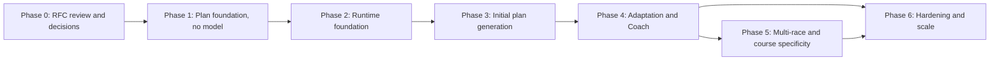

# Phased implementation roadmap

- Status: Accepted (RFC #86, amended by decisions D1–D8 in #94)
- Issues are created for near-term work only, per the [planning workflow](../../planning-workflow.md). Phase 1 is tracked by parent issue [#95](https://github.com/Julestblt/Stride/issues/95) and specified in the [plan foundation spec](../../specs/spec-plan-foundation/spec-plan-foundation.md). Later phases get a spec and issues when they become near-term; the drafts below are starting points.

## BMAD path

1. The product owner recorded decisions D1–D8 on 2026-10-13 ([risks and decisions](risks-and-decisions.md)).
2. Issue #94 promotes them into this RFC, accepts ADRs 0007–0012, adds the plan requirements to the PRD (FR-19 to FR-30) and writes the Phase 1 spec.
3. Each later phase starts with its own BMAD spec, then its issues.

## Phases

| Phase | Goal                                                                                                                        | Exit criteria                                                                                                                       |
| ----- | --------------------------------------------------------------------------------------------------------------------------- | ----------------------------------------------------------------------------------------------------------------------------------- |
| 0     | Decisions D1–D8; PRD requirements; accepted ADRs; Phase 1 spec                                                              | Decisions recorded; ADRs accepted; PRD and spec merged                                                                              |
| 1     | Deterministic plan model, targets, validator, skeleton, complete detailing, schema, matching and read-only plan UI          | Fully detailed deterministic plans built from fixtures pass all rule tests; RLS tests pass; plan screens render the athlete's draft |
| 2     | Model gateway, run tables, worker service, tools, SSE, evaluation harness with LLM judge; existing skills on Haiku 5.5 (D7) | A fake-model workflow runs end-to-end in CI; a live smoke run succeeds in staging within its run caps                               |
| 3     | Workflow A end to end                                                                                                       | Acceptance criteria met on the initial-plan scenarios, including the LLM-judge rubric and all safety cases                          |
| 4     | Workflows B, C, E; Coach screen; Historique; monitors; weekly review                                                        | Adaptation scenarios pass; undo works; monitor costs within estimates                                                               |
| 5     | Workflow D; race demands in specific phases                                                                                 | Multi-race scenarios pass; race-role classification matches the scenario labels ≥ 90%                                               |
| 6     | Cost views, garmin_mcp feeds, downgrade experiments; quotas only if observed usage requires them (D4)                       | Cost and latency targets hold for the athletes using Stride                                                                         |

## Proposed Stride issues

### Phase 1 — Plan foundation

Filed as [#95](https://github.com/Julestblt/Stride/issues/95) with sub-issues #96 (domain model), #97 (time zone, weekly ceiling, unavailable dates), #98 (targets), #99 (validator), #100 (templates, skeleton, feasibility), #101 (session library and complete detailing), #102 (read-only plan screens), #103 (schema, RLS and versioned apply) and #104 (matching and Régularité). The contract is the [plan foundation spec](../../specs/spec-plan-foundation/spec-plan-foundation.md).

### Phase 2 — Runtime foundation

| Draft title                                         | Scope                                                                                                                                                              | Acceptance highlights                                                       |
| --------------------------------------------------- | ------------------------------------------------------------------------------------------------------------------------------------------------------------------ | --------------------------------------------------------------------------- |
| [Feature]: Model gateway with Anthropic adapter     | Port, adapter on `@anthropic-ai/sdk`, routing and price tables, usage accounting, refusal handling, fake gateway for tests                                         | No provider import outside the gateway; usage recorded per call             |
| [Spike]: Worker database role and pooler            | Verify a custom login role through Supavisor session mode and `GRANT authenticated`; document fallback                                                             | Written result in the issue; no hosted change without approval              |
| [Feature]: Agent run tables and private functions   | `agent_runs`, steps, events, claim and lease functions, enqueue and decision RPCs                                                                                  | Concurrency tests for claims; idempotency; singleton per athlete            |
| [Feature]: Coach worker service                     | Entrypoint, claim loop with LISTEN and polling, scheduler, budgets, cancellation, graceful shutdown, packaging; Dokploy service definition                         | Restart resumes from memoized steps; deployment is an approval checkpoint   |
| [Feature]: Tool registry and athlete context packet | Registry, `AthleteScope`, read and compute tools, context packet with provenance and size budget                                                                   | Tool isolation tests; packet under 5,000 tokens on fixtures                 |
| [Feature]: Run progress streaming                   | SSE route handler over run events, reconnection with last event id, French status lines                                                                            | Works through the deployment proxy without buffering                        |
| [Feature]: Coaching evaluation harness              | Fixtures, scenario format, fake-model runner, live runner within run caps, LLM judge with written rubric and seeded defects, versioned results, label-gated CI job | Scenario catalogue v1 runs; judge catches seeded defects; results committed |

### Phases 3–6 (drafted when near-term)

- Phase 3: plan design skill for every week and repair loop; explanation with numeric guard; proposal review, accept and apply; Sports Director consult and race-calendar module; LLM-judge evaluation of initial plans.
- Phase 4: Coach screen with daily threads, questions and memory facts; Workflow B tools and the approve-change sheet; Historique ledger and undo; monitors and Workflow C triage with Recovery & Health; condition reports; weekly review that re-checks the coming week, with Batch; morning brief and Today.
- Phase 5: Workflow D and plan race roles; Course Strategist race demands feeding specific phases.
- Phase 6: cost views; kill-switch drill; garmin_mcp change feed; Sonnet-for-plan-design and second-provider evaluations; quotas, automatic minor changes and Garmin push only if the product owner revisits D3, D4 or D5.

## garmin_mcp follow-ups

GitHub Issues are enabled on garmin_mcp. G4 (heart-rate zones, lactate threshold and athlete metrics) is filed as Julestblt/garmin_mcp#8 and G6 (`(select auth.uid())` in policies) as Julestblt/garmin_mcp#9. G5 (private network access) and the drafts below are filed when they become near-term.

### G8 — Consumer change feed

- **Context:** Stride's coaching monitors must react to newly imported activities and daily metrics without scanning every athlete, and Stride migrations may not add triggers on garmin_mcp tables.
- **Scope:** expose per-user import progress Stride can read under RLS, either as a small owner-readable table updated by the worker (`provider_import_cursor`: user, category, last imported at, last source update) or as an outbox of sync-completed events; document the contract.
- **Acceptance:** a consumer can ask "what changed since T for this user" with one indexed query; replay-safe; covered by migration smoke tests.

### G9 — Audience-bound credentials for MCP

- **Context:** the MCP endpoint accepts the general Supabase user token, while the MCP specification says servers must not accept tokens not issued for them.
- **Scope:** only if MCP is offered to agents or third-party clients: audience-restricted tokens or an OAuth layer with per-tool scopes; keep the REST contract unchanged.
- **Acceptance:** tokens without the garmin_mcp audience are rejected on `/mcp`; documented migration for existing consumers.

### G10 — Workout push (deferred)

- **Context:** the workout-detail design shows "Envoyer sur Garmin".
- **Scope:** deferred by decision D5; only if the product owner revisits it: an authenticated endpoint that schedules one structured workout per explicit athlete action, idempotent and verifiable, with a disconnect-safe failure mode.
- **Acceptance:** no write without an explicit per-action request; audit log; contract tests with recorded fixtures.
