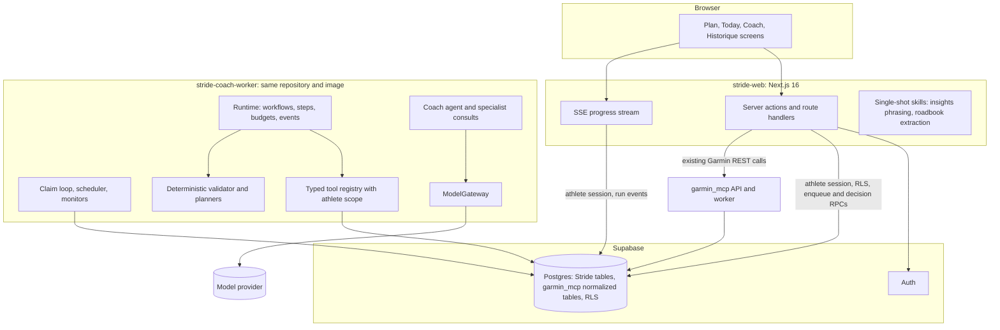
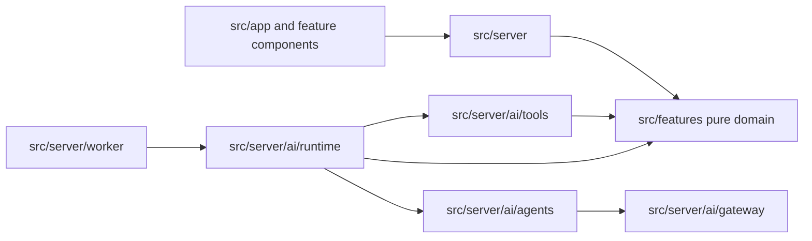
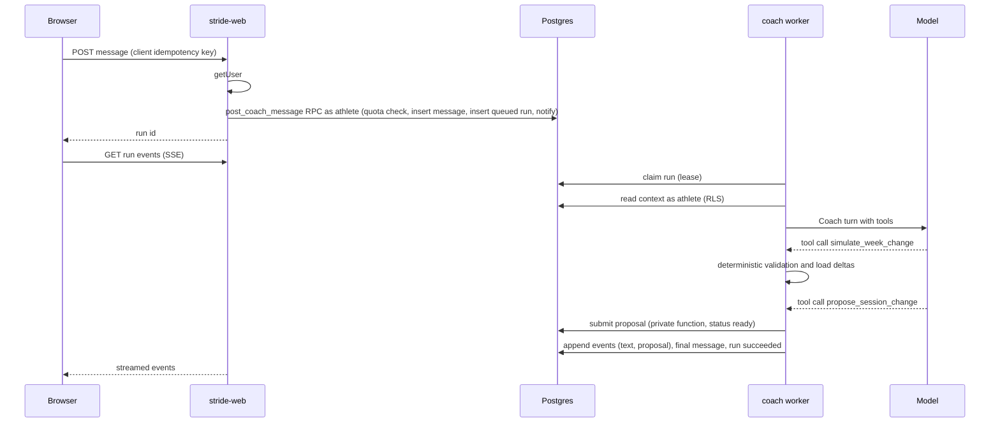
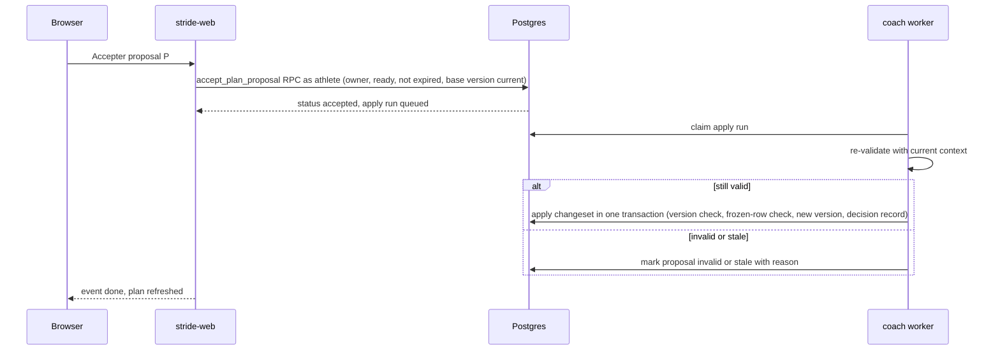

# Target architecture

- Status: Proposed (RFC #86)
- Paradigm: a hexagonal coaching core with code-orchestrated workflows and a propose → validate → approve ledger.

## In one paragraph

Deterministic TypeScript domain modules own every number, date and safety rule. A single Coach agent, running in a dedicated worker, reads authorized athlete data through typed tools and uses a language model only where judgment or language is needed: designing a plan within computed bounds, choosing among valid adaptations, interpreting free text and explaining decisions in French. Everything it wants to change becomes a typed proposal that the deterministic validator checks before the athlete sees it. The athlete approves or rejects in the web app, and the worker, the only writer of plan state, applies the change as a new immutable plan version. Garmin data comes from garmin_mcp's normalized rows, never from live Garmin calls by the model.

## Components



| Component             | Responsibilities                                                                                                                                                                                                        | Holds                                                                                                       |
| --------------------- | ----------------------------------------------------------------------------------------------------------------------------------------------------------------------------------------------------------------------- | ----------------------------------------------------------------------------------------------------------- |
| `stride-web`          | Authenticate with `getUser`; enqueue runs and record approvals through athlete-session RPCs that check quotas; stream run events over SSE; render plans, proposals and the ledger; keep the existing single-shot skills | Publishable key, athlete sessions, existing constrained onboarding key, provider key for single-shot skills |
| `stride-coach-worker` | Claim runs; build context packets; execute workflows, agent loops and specialist consults; validate; persist steps, events, proposals and messages; apply accepted proposals; run monitors and the weekly scheduler     | Worker database role credential, model provider key                                                         |
| Supabase Postgres     | Source of truth for plans, proposals, decisions, runs, conversations and memory; RLS for every athlete-owned row; private functions for privileged writes                                                               | —                                                                                                           |
| garmin_mcp            | Unchanged: Garmin connection, sync and normalized rows; intraday wellness for the web app                                                                                                                               | Garmin sessions                                                                                             |
| Model provider        | Inference only; no data stored by default on the selected models ([models and costs](models-and-costs.md#provider-data-handling))                                                                                       | —                                                                                                           |

## Invariants

These rules are the contract every implementation issue must follow. They were distilled through the BMAD architecture workflow; rationale is in the linked documents and ADRs.

| ID    | Rule                                                                                                                                                                                                                                                                                                                                                                                                                    | Prevents                                                                            |
| ----- | ----------------------------------------------------------------------------------------------------------------------------------------------------------------------------------------------------------------------------------------------------------------------------------------------------------------------------------------------------------------------------------------------------------------------- | ----------------------------------------------------------------------------------- |
| AD-1  | Workflows are deterministic code. LLM steps return schema-validated intents or typed operations. Every plan change becomes a proposal checked by the deterministic validator before the athlete sees it.                                                                                                                                                                                                                | Agent-owned control flow, free-form plan writes                                     |
| AD-2  | Only the coach worker materializes plan versions, through private database functions, from an accepted proposal it re-validates at apply time. Route handlers, LLM tools and athlete RPCs never write `plan_*` rows. Agents never modify athlete-owned profile, goal or race rows; plan-level race roles live in plan versions.                                                                                         | Two mutation paths; approvals that skip validation                                  |
| AD-3  | Blocks, weeks and sessions are revisioned rows with a stable key and a version range. Versions are immutable. Sessions before the athlete's local today, or matched to an activity, are frozen by the database.                                                                                                                                                                                                         | History rewrites, snapshot bloat                                                    |
| AD-4  | A proposal is a closed set of typed operations against an expected base version, carrying origin, requester, evidence, assumptions, uncertainty, specialist opinions, validator report and expiry. Status moves along draft → ready → accepted → applied, or to rejected, expired, superseded, stale, invalid or reverted. At most one ready proposal exists per target; a newer one supersedes overlapping older ones. | Ad-hoc change formats, unexplained changes                                          |
| AD-5  | A run's athlete is set by trusted code only (`auth.uid()` in the enqueue RPC, or the scheduler from Stride-owned state). Tools receive an athlete scope, never an athlete id from model output. Reads run under RLS as that athlete.                                                                                                                                                                                    | Confused-deputy access                                                              |
| AD-6  | Tools are typed functions with Zod schemas. Read tools return minimized, provenance-tagged data. Write tools only submit proposals, questions or memory facts. No SQL, HTTP, filesystem, shell, admin or Supabase management tool exists in production.                                                                                                                                                                 | Privilege escalation through tools                                                  |
| AD-7  | The runtime reads normalized garmin_mcp rows under RLS and derives freshness from connection and sync rows. It never writes garmin_mcp tables and does not call the garmin_mcp MCP endpoint in production.                                                                                                                                                                                                              | Live provider calls from agents; UI and coach disagreeing                           |
| AD-8  | The Coach is the only tool-using agent. Sports Director, Course Strategist and Recovery & Health are deterministic modules plus at most one depth-one consult each per run, returning a validated opinion whose constraints use the shared `ConstraintSpec` union. Conflicts resolve as safety, athlete constraints, race priority, progression, preference.                                                            | Circular delegation, contradictory outputs                                          |
| AD-9  | A validator `block` is final. Every rule declares an evidence grade and a severity. The validator runs at submission and at apply.                                                                                                                                                                                                                                                                                      | A model or tone overriding a safety rule                                            |
| AD-10 | All LLM calls go through the `ModelGateway` port with a versioned routing table, one versioned price table, per-call budgets and usage accounting. Provider SDKs live only in gateway adapters.                                                                                                                                                                                                                         | Provider sprawl, unaccounted spend                                                  |
| AD-11 | The web service authenticates, enqueues, streams and records decisions. One worker service executes every multi-step or tool-using run. Single-shot stateless skills may stay in the web process. No Edge Functions or external workflow engine.                                                                                                                                                                        | Long runs dying with deploys; privileged credentials on the internet-facing process |
| AD-12 | `agent_runs` is the job record: lease claim with `FOR UPDATE SKIP LOCKED`, attempts and backoff, cancellation flag, idempotency key, one active plan-mutating run per athlete. Steps are memoized by `(run_id, step_key)`. Events are append-only.                                                                                                                                                                      | Duplicate execution, lost or double-paid work                                       |
| AD-13 | Every run has hard caps for tokens, cost, tool calls, model calls and wall clock. Quotas are checked at enqueue and during the run. Exhaustion yields a degraded deterministic result.                                                                                                                                                                                                                                  | Runaway loops, overspend                                                            |
| AD-14 | Athlete and provider free text enters prompts only inside delimited data blocks with provenance and length caps. Numbers in athlete-facing explanations must trace to computed facts.                                                                                                                                                                                                                                   | Prompt injection, invented numbers                                                  |
| AD-15 | Red flags trigger deterministic hard stops and referral copy. Health data in prompts is limited to the task. Transcripts expire. Models that require provider-side 30-day retention are not used with athlete data.                                                                                                                                                                                                     | Medical claims, unsafe continuation, data sprawl                                    |
| AD-16 | Prompt, routing and model changes ship only after the coaching evaluation suite meets its thresholds. Rules have unit tests. RLS and tool isolation tests are mandatory for every new table and tool.                                                                                                                                                                                                                   | Silent regressions                                                                  |
| AD-17 | Planned-versus-completed matching and adherence are computed only by the plans matching module and persisted in `session_activity_matches`, including athlete overrides.                                                                                                                                                                                                                                                | Different adherence answers in different places                                     |



Dependency rules: `src/features` imports nothing from `src/server`, Next.js, Supabase or provider SDKs. Only `src/server/ai/gateway` imports a provider SDK. Client components never import `src/server`.

## Runtime flows

### A conversation turn that proposes a change



### Approval and apply



### Background plan generation

The athlete starts the run; the worker executes memoized steps and streams progress such as "J'analyse ton historique Garmin". The detailed step list is in [workflows](workflows.md#a-initial-plan-generation).

### Monitors and schedules

The worker's scheduler runs cheap deterministic monitors (new activities to match, single-session spikes, missed key sessions, readiness red flags, data freshness) for athletes with an active plan, and creates an LLM run only when a monitor finds something that needs a proposal and the athlete's budget allows it. A weekly review runs on Sunday evening in Europe/Paris for opted-in athletes and uses the Batch API when the result is not needed immediately.

## Deployment topology

| Service                   | Image and command                                                              | Network                                                      | Scaling                                                                   |
| ------------------------- | ------------------------------------------------------------------------------ | ------------------------------------------------------------ | ------------------------------------------------------------------------- |
| `stride-web`              | Next.js standalone build                                                       | Public through Traefik (TLS); internal to garmin_mcp         | One instance initially                                                    |
| `stride-coach-worker`     | Same image, worker entrypoint started with the `react-server` export condition | No inbound port; outbound to Supabase and the model provider | One instance initially; more instances are safe because claims are leased |
| garmin_mcp API and worker | Unchanged                                                                      | Internal                                                     | Unchanged                                                                 |

- Configuration: the worker needs the database connection string for its dedicated role, the model provider key and the routing table version. The web service does not receive either secret. Secrets come from the existing secret manager, never from the repository.
- Shutdown: on `SIGTERM` the worker stops claiming, aborts in-flight model calls through `AbortController`, and lets leases expire or releases them. Memoized steps make the re-run resume after the last completed step.
- Database connection: the worker uses Supavisor session mode (IPv4) or a direct connection; transaction mode is not used because it drops session state and LISTEN ([Supabase connections](https://supabase.com/docs/guides/database/connecting-to-postgres)).
- Streaming: Traefik must not buffer SSE responses; route handlers set `Cache-Control: no-store` and `X-Accel-Buffering: no`.
- Environments: CI uses the isolated Supabase stack and a fake model gateway; staging uses its own Supabase project and a separate provider workspace with a low spend limit; production keys are separate and spend-limited at the provider.

## Operational complexity

New things to operate: one worker container, one database login role, one provider account and key, a daily cost view and a kill switch. Nothing new is stateful outside Postgres. Runbooks to write with the first implementation: rotate the provider key, pause all coaching runs, drain and redeploy the worker, inspect a failed run, and purge expired transcripts.

## Source layout seed

```text
src/features/plans/          # plan model, operations, validator, skeleton, templates, matching (pure)
src/features/progress/       # existing load, recovery and records measures reused by the engine
src/features/races/          # existing course analysis reused for race demands
src/server/plans/            # repositories, enqueue and decision actions (athlete session)
src/server/coach/            # SSE progress and message route support
src/server/ai/gateway/       # ModelGateway port and provider adapters
src/server/ai/runtime/       # runs, steps, budgets, events, workflows
src/server/ai/agents/        # Coach and specialist definitions
src/server/ai/tools/         # typed tool registry and athlete scope
src/server/ai/context/       # athlete context packet builders
src/server/worker/           # worker entrypoint, claim loop, scheduler
tests/evals/coaching/        # scenario fixtures, runner, recorded results
```

## Mapping to the AI runtime boundary

| ADR 0003 responsibility | Where it lives                                                                               |
| ----------------------- | -------------------------------------------------------------------------------------------- |
| Orchestration           | `src/server/ai/runtime` workflows                                                            |
| Agents                  | `src/server/ai/agents` (Coach, specialist consults)                                          |
| Skills                  | `src/server/ai/skills` (prompt modules loaded per workflow)                                  |
| Context building        | `src/server/ai/context`                                                                      |
| Schemas                 | Zod schemas next to their owner; shared proposal and opinion schemas in `src/features/plans` |
| Tool access             | `src/server/ai/tools`                                                                        |
| Domain logic            | `src/features/plans`, `progress`, `races`                                                    |
| Observability           | Run, step and event records plus structured logs                                             |
| Evaluation              | `tests/evals/coaching` ([observability and evaluation](observability-and-evaluation.md))     |
