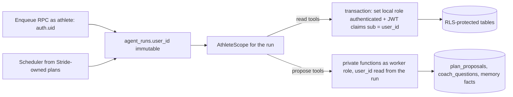

# Tools, Garmin integration and authorization

- Status: Accepted (RFC #86)
- Decision record: [ADR 0010](../../adr/0010-internal-tools-and-garmin-normalized-data.md)

## Part 1 — Garmin data for the coaching runtime

### Evaluation of the garmin_mcp MCP endpoint

| Question                         | Finding (verified on 2026-10-12)                                                                                                                                                                                          | Consequence                                                                                                        |
| -------------------------------- | ------------------------------------------------------------------------------------------------------------------------------------------------------------------------------------------------------------------------- | ------------------------------------------------------------------------------------------------------------------ |
| Tool inventory                   | Ten read-only tools by default: activities, activity, splits, stats, sleep, HRV, training readiness, training status, resting HR, VO₂ max trend; configurable allowlist; mutation tools refused at startup in Stride mode | Covers less than the normalized tables (no tracks, laps across many activities, sync freshness, weekly patterns)   |
| Multi-user sessions              | Stateless streamable HTTP; each call builds a per-user Garmin client from the encrypted session and persists refreshed tokens; leases serialize use with the sync worker                                                  | Correct isolation, but every tool call can wait on or delay sync                                                   |
| Supabase JWT forwarding          | The caller sends the athlete's Supabase access token; the service verifies it with `GET /auth/v1/user` on every request                                                                                                   | Background runs have no live athlete token; each call adds an Auth round trip                                      |
| Tenant isolation                 | The tenant comes only from the verified token; tools cannot choose a user id                                                                                                                                              | Good                                                                                                               |
| Exposed data                     | Garmin-shaped payloads from live Garmin Connect                                                                                                                                                                           | Verbose; the reference project measured sleep payloads above 400 KB and repeated context compactions               |
| Normalized data missing from MCP | Tracks and heart-rate histograms, multi-activity lap history, observation availability flags, sync categories, training-week patterns                                                                                     | The normalized tables are the richer source                                                                        |
| Freshness and sync status        | Not exposed through MCP                                                                                                                                                                                                   | Must come from `sync_jobs` and `provider_connections`                                                              |
| Tool-level authorization         | Allowlist only; one token grants all enabled tools                                                                                                                                                                        | No per-tool scopes                                                                                                 |
| Token audience                   | Accepts the general Supabase user token, not a token issued for the MCP server                                                                                                                                            | The MCP specification says servers "MUST NOT accept any tokens that were not explicitly issued for the MCP server" |
| Performance and rate limits      | Live Garmin calls; Garmin rate-limited onboarding logins on 2026-10-09 (draft G2)                                                                                                                                         | Agent loops would multiply Garmin traffic                                                                          |

**Decision:** the production coaching runtime does not use the garmin_mcp MCP endpoint. It reads normalized rows under RLS, which garmin_mcp already maintains for exactly this purpose, and which are the same data the athlete sees in Activités and Progression. The MCP endpoint stays useful for interactive, developer-facing exploration. Amended by [#130](../../adr/0010-internal-tools-and-garmin-normalized-data.md#amendment-2026-10-15-130): the Coach and Medical may call an allowlist of read-only garmin_mcp MCP tools for interactive drill-down.

### Data contract used by the runtime

| Coaching need              | Normalized source                                                          | Notes                                                                                   |
| -------------------------- | -------------------------------------------------------------------------- | --------------------------------------------------------------------------------------- |
| Training history           | `provider_activities`, `provider_activity_segments`                        | Running family: running, treadmill, track, trail, ultra; cross-training kept separately |
| Intensity and time in zone | `provider_activity_tracks.heart_rate_histogram` with Stride zone estimates | 90-day default window; absence is reported, not zero                                    |
| Daily recovery             | `provider_observations` (domain `recovery`)                                | Today's values are `partial`; missing values are `missing`                              |
| Fitness and load           | `provider_observations` (domain `fitness`)                                 | Garmin acute/chronic load, VO₂ max, training status                                     |
| Freshness                  | `provider_connections`, `sync_jobs`                                        | Category states and last success drive the data-quality section of the context packet   |
| Intraday detail            | `GET /v1/wellness/days/{date}` from the web process only                   | Used for athlete-initiated questions about one day; not available to background runs    |

### Detecting new data without scanning

Stride migrations must not reference garmin_mcp tables ([ADR 0005](../../adr/0005-shared-supabase-schema-ownership.md)), so Stride cannot add triggers there. V1 monitors iterate only athletes with an active plan and read `max(imported_at)` under each athlete's RLS scope every 15 minutes; this is cheap at Stride's scale. The proposed garmin_mcp draft G8 (a per-user change cursor or sync-completed event) removes the scan before scale requires it.

## Part 2 — Stride tools

### Registry contract

Every tool is declared once:

| Field                 | Purpose                                                                                 |
| --------------------- | --------------------------------------------------------------------------------------- |
| `name`, `description` | Model-facing; English, stable                                                           |
| `input`               | Zod schema; strict; no athlete identifiers                                              |
| `output`              | Zod schema; minimized fields; size cap                                                  |
| `class`               | `read`, `compute`, `propose` or `record`                                                |
| `scope`               | Which workflows may expose it                                                           |
| `dataClass`           | `training`, `health` or `plan` — health tools are offered only when the task needs them |
| `costUnits`           | Counted against the run's tool budget                                                   |

The runtime builds the tool list per workflow, executes calls with the run's `AthleteScope`, validates inputs and outputs, truncates or paginates oversized results with an explicit `truncated` flag, and returns structured errors (`not_found`, `out_of_scope`, `stale_version`, `validation_failed`, `budget_exhausted`) the model can act on.

### Registry as built (#137)

The Managed Agents runtime uses a first slice of this contract in `src/server/coaching/tools`:

- One module per tool declares `name`, `description` (English), `class`, `dataClasses`, a strict Zod `input`, a Zod `output` and its handler (`defineTool` in `define.ts`). `registry.ts` lists the tools and which agent gets which (`agentTools`).
- `runCustomTool` parses the input, runs the handler with the session's athlete (`OnboardingContext` user client plus `.eq("user_id")`), and parses the output before it reaches the agent. A result that fails its schema is logged server-side and returned as `tool_unavailable`.
- Errors are `{ code, message }` with a French `message`; `invalid_input`, `invalid_plan`, `validation_failed` and `not_found` add structured `details` produced by Stride's own validators so the agent can correct its call. Codes come from `toolErrorCodes` in `errors.ts`: `invalid_input`, `not_found`, `no_active_plan`, `range_too_large`, `validation_failed`, `invalid_plan`, `unknown_tool`, `tool_unavailable`. Database and unexpected errors never expose their message.
- Absent values are omitted rather than sent as `null` or `0`, except inside session content from `read_active_plan`, whose shape is the operation contract for `replace_session`. Garmin-derived values carry `source` and `asOf`.
- The agents' custom tool blocks in `managed-agents/agents/*.md` are generated between `# stride-tools:start` and `# stride-tools:end` from `z.toJSONSchema` (`npm run agents:tools`). `npm run agents:tools:check` and the unit suite fail on drift and name the agent file and tool.
- `tests/integration/coaching-tools.test.ts` seeds two athletes on the CI-local Supabase and runs every tool as the first athlete: no row of the second appears, and the second athlete's proposal id or session key returns `not_found` (`npm run test:integration`, CI only).

| Tool                      | Class   | Data classes     | Agents         |
| ------------------------- | ------- | ---------------- | -------------- |
| `read_athlete_context`    | read    | training, health | Coach, Medical |
| `read_active_plan`        | read    | plan             | Coach          |
| `read_plan_progress`      | read    | plan, training   | Coach          |
| `read_plan_history`       | read    | plan             | Coach          |
| `read_health_reports`     | read    | health           | Coach, Medical |
| `submit_plan`             | propose | plan             | Coach          |
| `create_plan_proposal`    | propose | plan             | Coach          |
| `ask_athlete`             | propose | plan             | Coach          |
| `record_condition_report` | record  | health           | Medical        |
| `update_condition_report` | record  | health           | Medical        |

`ask_athlete` has no server handler: the session validates its input through the registry and pauses the turn until the athlete answers.

Health record (#200): `record_condition_report` and `update_condition_report` write `athlete_condition_reports` as the athlete under RLS, with `source = coach_confirmed`. Medical records only what the athlete stated or confirmed with `ask_athlete` and never estimates a severity. `read_health_reports` returns the open reports and those resolved in its window, with their ids. `loadPlanningInput` passes the open reports and Garmin `training_readiness` for yesterday and today to the validator, so H1–H3 run on the deterministic draft and on every Coach proposal (`submit_plan`, `create_plan_proposal`, `extend_plan`). Readiness below 25 is red, 25–49 amber and 50 or more green, following Garmin's bands. A day without a score is left out, so H3 is skipped without data.

Context packet: `read_athlete_context` keeps eight weeks of running history, the last seven days of check-ins, upcoming races and unavailability only, and pace, heart-rate and RPE ranges without the talk-test copy. On the unit-test fixture (`tests/unit/coaching-tools-fixture.ts`) the packet went from 7,212 bytes to 3,429 bytes; the test enforces a 4,096-byte budget.

Not built yet: `scope`, `costUnits`, run budgets, truncation flags and the `out_of_scope`, `stale_version` and `budget_exhausted` codes, which belong to the Postgres worker runtime. A stale base version is returned as `validation_failed` with `details.reason = "stale_version"`.

### Catalogue

| Tool                     | Class   | Returns or does                                                                                                                         |
| ------------------------ | ------- | --------------------------------------------------------------------------------------------------------------------------------------- |
| `get_athlete_profile`    | read    | Availability, preferences, terrain, access, injury-history flags                                                                        |
| `get_goals_and_races`    | read    | Goal focus, races with athlete priority and plan role, race demands                                                                     |
| `get_history_summary`    | read    | Deterministic weekly summary, longest runs, consistency, coverage                                                                       |
| `get_activities`         | read    | Up to 60 compact activities in a date range                                                                                             |
| `get_activity_detail`    | read    | One activity summary with laps and zone time; never raw tracks                                                                          |
| `get_readiness`          | read    | Readiness assessment, signals with usual ranges, check-ins, active condition reports                                                    |
| `get_plan`               | read    | Current version: block, week targets, sessions for a date range, pending proposals                                                      |
| `get_adherence`          | read    | Stored planned-versus-completed matches for a range                                                                                     |
| `get_plan_history`       | read    | Recent decisions and their outcomes for explanations                                                                                    |
| `get_memory_facts`       | read    | Active facts with provenance                                                                                                            |
| `simulate_change`        | compute | Applies candidate operations in memory and returns the validator report and load deltas; persists nothing                               |
| `check_race_calendar`    | compute | Spacing, taper and recovery conflicts between races                                                                                     |
| `propose_session_change` | propose | Move, swap, shorten, replace or skip one future session                                                                                 |
| `propose_week_revision`  | propose | Operations within one future week                                                                                                       |
| `propose_block_revision` | propose | Replace targets and sessions from a future date to a block end                                                                          |
| `propose_plan`           | propose | Plan-generation workflows only; never exposed in conversation                                                                           |
| `ask_athlete`            | propose | A structured question with options, shown in the Coach screen                                                                           |
| `record_memory_fact`     | propose | A non-health fact with provenance, visible and editable by the athlete; health facts go through a condition report the athlete confirms |

There is no tool to read another athlete, run SQL, fetch URLs, send messages outside Stride, read files, push to Garmin or change goals and races.

### Authorization model

| Principal                                  | May                                                                                                                                                                                                                                                          | May not                                                                                    |
| ------------------------------------------ | ------------------------------------------------------------------------------------------------------------------------------------------------------------------------------------------------------------------------------------------------------------ | ------------------------------------------------------------------------------------------ |
| Athlete session (`authenticated`)          | Read own rows; write athlete-authored tables (feedback, condition reports, answers, memory edits, settings); call enqueue, message, accept, reject, undo and cancel RPCs that check ownership and state                                                      | Write plan tables, proposals, runs or steps directly                                       |
| Worker role (`stride_coach_worker`, login) | Claim and update runs; impersonate `authenticated` for one athlete per transaction to read; execute private functions that write proposals, questions, facts, messages, steps, events, matches and plan versions, always taking the athlete from the run row | Bypass RLS; read garmin_mcp secrets, challenges or other services' private tables; run DDL |
| Model                                      | Choose tools from the per-workflow list                                                                                                                                                                                                                      | Supply athlete identifiers, reach the database, see secrets                                |

### Proposal tools in detail

- Inputs are typed operations, never free-form patches:
  - `move_session`, `swap_sessions`, `shorten_session`, `replace_session`, `skip_session`, `add_session`;
  - `set_week_targets`, `replace_range`, `set_race_role`, `create_plan`;
  - `extend_plan` (weeks added after the plan's end) and `rewrite_range` (#207: the blocks, weeks and sessions of a Monday-to-Sunday range replaced together, weeks outside the range unchanged; exposed to the Coach as `rewrite_plan_range`).
- The worker resolves operations against the base version, runs the validator, computes the load deltas and before/after shapes, and stores the proposal as `ready` only if no rule blocks. Otherwise the tool returns the violations, and the model may revise within its budget.
- Each proposal has an expiry: end of day for same-day sessions, 48 hours for week changes, 7 days for block and plan proposals.
- Idempotency: the run id plus a step key identifies each submission, so a retried step cannot create a duplicate.
- A new proposal for an overlapping target supersedes the older ready one.

## Part 3 — Should Stride expose an MCP server?

Not now. MCP earns its cost when several independent clients need the same tools over a network boundary. Today there is one client — the coach worker — in the same codebase, and an MCP layer would add transport, an OAuth audience model, scope design, schema duplication and a second authorization surface without reuse.

Revisit when an external client needs athlete-authorized access, for example an athlete connecting their own assistant to Stride. That facade would be read-only at first, use OAuth with audience-bound tokens and per-tool scopes, and wrap the same registry so there is still one implementation of each tool. The Supabase development or management MCP is never connected to production coaching agents.
