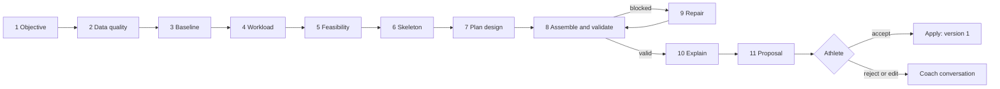
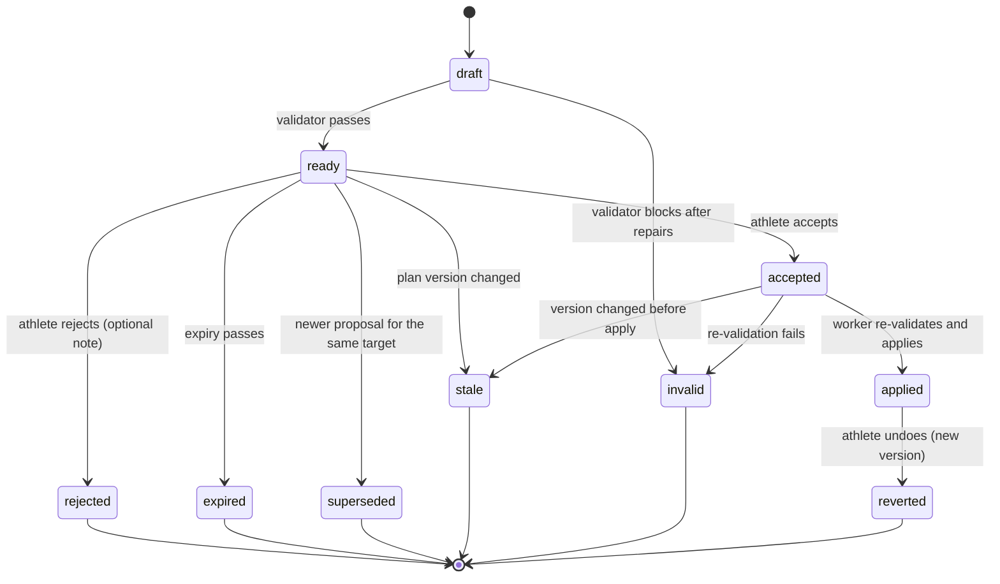

# Planning and adaptation workflows

- Status: Proposed (RFC #86)
- Every workflow is a run in `agent_runs`, executed by the coach worker as memoized steps. Steps marked **D** are deterministic code; **L** steps call a model through the gateway; **A** steps wait for the athlete.

## Common rules

- A workflow starts only from an athlete action or from the scheduler for an athlete with an active plan who opted into proactive reviews.
- Before any L step, a data-quality gate decides which branch runs ([deterministic coaching](deterministic-coaching.md#missing-and-uncertain-data)).
- Plan-mutating workflows hold the athlete's single plan-mutation slot; a second request waits or is refused with an explanation.
- Every L step has a budget; when a budget is exhausted the workflow returns its best deterministic result and says what was not done.
- Progress events stream short French status lines; the final result is a proposal, a message, or both.
- Nothing changes in the plan until the athlete accepts and the apply step succeeds.

## A. Initial plan generation

Trigger: the athlete has completed onboarding, connected Garmin, entered at least one race or a goal focus, has no active plan, and clicks "Créer mon plan".

| #   | Step                                                                                                                                                                                             | Kind                                                                                                   | Output                                            |
| --- | ------------------------------------------------------------------------------------------------------------------------------------------------------------------------------------------------ | ------------------------------------------------------------------------------------------------------ | ------------------------------------------------- |
| 1   | Resolve the main objective: the A-priority race, else the nearest dated race, else the goal focus; ask if two A races are close or the choice is ambiguous                                       | D (+ A)                                                                                                | Objective, candidate race roles                   |
| 2   | Assess Garmin completeness: sync category states, oldest synchronized date, weeks of running history, calibration gaps                                                                           | D                                                                                                      | Data-quality report and branch                    |
| 3   | Build the athlete baseline: last 16 weeks of volume, longest runs, consistency, intensity distribution, readiness ranges, records and estimates with confidence                                  | D                                                                                                      | Baseline section of the context packet            |
| 4   | Determine realistic workload: held volume (average of the last four complete weeks), peak = held volume × template factor, lead-in ramp if needed, availability ceilings                         | D                                                                                                      | Workload envelope                                 |
| 5   | Assess feasibility: weeks available versus template minimum; long-run progression possible under the single-session spike rule; race demands versus envelope; target time versus estimate band   | D, then Sports Director consult when more than one race or when the result is ambitious or unrealistic | Feasibility verdict with reasons and alternatives |
| 6   | Create the plan skeleton: template by race kind and distance, phases stretched or compressed deterministically, recovery weeks, taper, race week and post-race recovery, slots on available days | D                                                                                                      | Blocks and weekly targets                         |
| 7   | Design the plan: block intents, key sessions per week from the workout library, progression of key sessions, adjustments within the allowed envelope, race-specific work from race demands       | L (Opus 5.5, high)                                                                                     | Typed plan design                                 |
| 8   | Assemble and validate: fill easy, long and recovery sessions deterministically, detail the next two weeks fully, mark later weeks provisional, run the validator                                 | D                                                                                                      | Candidate plan + validator report                 |
| 9   | Repair if blocked: send violations back; at most two repairs; if still blocked, reduce scope (shorter horizon or conservative template) and say so                                               | L + D                                                                                                  | Valid draft                                       |
| 10  | Explain: plan summary, why this structure, assumptions, uncertainty, what Stride does not know; numeric guard on every number                                                                    | L (Sonnet 5.5) + D                                                                                     | French rationale                                  |
| 11  | Submit the proposal (`create_plan`) for review; the athlete accepts, rejects with a note, or asks for changes in Coach                                                                           | D + A                                                                                                  | Proposal; on acceptance, version 1 of the plan    |

Branches:

- **Fewer than 4 weeks of running history**: ask for current weekly time and longest recent run (`ask_athlete`); use a base-building template with conservative ramp; feasibility confidence "low".
- **Import still running**: wait if activities are expected within minutes; otherwise plan on available weeks and record the assumption; the weekly review re-checks once the import completes.
- **Unrealistic objective**: never refuse silently. Offer alternatives: a later race, a shorter format, a different role for the race ("course de préparation"), or a base block before a decision.
- **Pain or illness active**: no plan generation with quality sessions; offer a return-to-running proposal only after the athlete marks the condition resolved.

## B. Single workout modification

Example: "Je ne peux pas jeudi. Déplace mon fractionné."

1. **D** Identify the target session (the interval session this week) and the constraint (Thursday unavailable). If ambiguous, ask.
2. **D** Load the week, the previous and next weeks' key sessions, readiness, and frozen sessions.
3. **L** The Coach generates two or three candidate moves (for example Wednesday with Tuesday's easy run moved, or Friday with Saturday's long run kept 48 hours later, or shortened on Friday).
4. **D** `simulate_change` scores each: validator result, spacing from other quality sessions and the long run, weekly load delta, availability.
5. **L** The Coach picks the best valid option, or the least disruptive one, and submits it; alternatives are listed as "options non retenues".
6. **A** The athlete accepts or keeps the current plan. The current plan is untouched until apply.

Nothing completed is moved. A request that touches a past or completed session gets an explanation instead of a proposal.

## C. Weekly or block adaptation

Triggers: the athlete reports unusual fatigue, pain or illness; key sessions are missed; completed load deviates significantly from plan; a monitor detects a single-session spike or a red readiness state.

1. **D** Triage classifies the situation:
   - noise (one easy run missed, load within ±15%): note only, no proposal;
   - week-level (a key session missed, two days of amber or red readiness, a 20–40% deviation): minimal week revision;
   - block-level (illness over 5 days, pain report, three or more missed key sessions in two weeks, sustained deviation): block revision;
   - safety: hard stop and referral.
2. **D** Compute the minimum change set: protect the next key session and the long run when safe; never "make up" missed volume; reduce intensity before volume when readiness is low; recover with an easier week when cumulative fatigue is high.
3. **L** The Coach (with a Recovery & Health consult when health signals are involved) chooses among the minimal options and explains.
4. **D** Validate and submit; at most one adaptation proposal per athlete per day from monitors.

Completed sessions, past decisions and earlier versions are never rewritten; a revision always starts tomorrow or later.

## D. Adding another race

1. **D** On a race added while a plan is active, Stride offers "Mettre à jour mon plan ?" rather than changing anything.
2. **D** The race-calendar check computes spacing, the main race's taper window, recovery needed after the new race, and whether the new race fits the current block.
3. **L** The Sports Director consult classifies the race for the plan:

| Role             | Typical conditions                                                                  | Plan effect                                                                                          |
| ---------------- | ----------------------------------------------------------------------------------- | ---------------------------------------------------------------------------------------------------- |
| Preparation race | Before the main race, smaller, completes recovery before the main taper begins      | Becomes a key session of its week; a short local taper and recovery                                  |
| Secondary goal   | Similar importance, compatible spacing                                              | Mini-taper, protected recovery, main structure kept                                                  |
| New primary goal | Athlete marks it A, or it replaces the original goal                                | Block-level revision or a new plan cycle                                                             |
| Incompatible     | Inside the main race's taper or recovery window, or demands far beyond the envelope | No change; explain and suggest alternatives (another date, shorter format, run it as a training day) |

4. **L + D** The Coach designs the revision (week or block level), the validator checks it, and the result is a proposal for a new version with a before/after view of the affected weeks.
5. **A** The athlete decides. The athlete's own race priority is never changed by the engine; the plan's race role is part of the plan version.

## E. Periodic follow-up

| Cadence                                                                    | Work                                                                                                             | Model use                                                                                                               |
| -------------------------------------------------------------------------- | ---------------------------------------------------------------------------------------------------------------- | ----------------------------------------------------------------------------------------------------------------------- |
| After each sync (polled every 15 minutes for athletes with an active plan) | Match activities to sessions, compute adherence, detect single-session spikes, missed key sessions and red flags | None unless triage asks for a proposal                                                                                  |
| Daily (05:30 Europe/Paris)                                                 | Morning brief: today's session, readiness state, data freshness                                                  | Deterministic text; optional Haiku phrasing with numeric guard                                                          |
| Weekly (Sunday 18:00 Europe/Paris, opted-in athletes)                      | Week summary, next week check, re-detail the next provisional week                                               | Deterministic when nothing is flagged; otherwise one Sonnet review through the Batch API, results before Monday morning |
| On demand                                                                  | Athlete asks for a review or explanation                                                                         | Conversation turn                                                                                                       |

Cost controls: no model call per synced activity; at most one monitor-triggered adaptation per athlete per day; weekly reviews skip the model when the deterministic check finds nothing to change.

## Proposal lifecycle

- **Undo**: "Annuler" on an applied change creates an inverse proposal that the athlete confirms in one action; it produces a new version, never edits the old one. Undo is unavailable once an affected session is completed or past.
- **Stale**: the athlete sees "Le plan a changé depuis cette proposition" and can request a fresh one.
- **Expiry**: the ledger shows the deadline ("à décider avant 17:00") from `expires_at`.
- **Automatic minor changes**: not in V1. If the product owner approves them later, they reuse this lifecycle with an `approval_mode = automatic`, a declared bound (for example ±10 minutes on an easy run), and an undo window ([risks and decisions](risks-and-decisions.md)).
